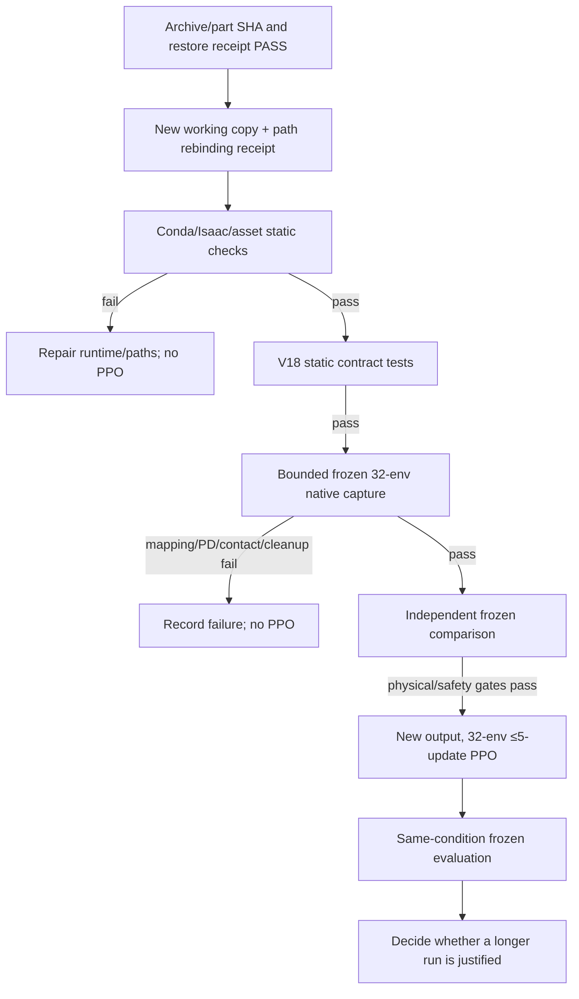

# X2 CReF Locomotion — Runtime Reproduction and Command Contract

> 작성 범위: 이 문서는 다른 컴퓨터에서 X2 CReF/Isaac locomotion을 **안전하게 다시 구성하고 작은 검증부터 실행**하기 위한 런타임 계약이다. 원본 학습 파일, checkpoint, reward, PD, SafeDirect, native limit을 바꾸지 않는다. 이 문서 작성 중 Isaac Sim, PhysX, PPO를 실행하지 않았다.
>
> 핵심 판정: 보관본은 파일·소스·checkpoint·실험 기록의 이식본이다. 새 컴퓨터에서 native simulator, contact, safety, gait가 재현되었다는 뜻은 아니다. `FILES_CHECKED_NATIVE_NOT_QUALIFIED`는 정상적인 파일 검증 결과이며 native PASS가 아니다.

## 1. 가장 먼저 알아둘 것

이 연구에는 서로 다른 세 실행 계열이 섞여 있다. checkpoint 이름만 같거나 `Uxx`가 비슷하다고 서로 바꿔 로드하면 안 된다.

| 계열 | 주된 소스/진입점 | checkpoint 계약 | 새 PC에서의 올바른 첫 실행 |
|---|---|---|---|
| HDMI native MLP/LMO/CReF | `workspace/HDMI/scripts/train.py` | HDMI PPO policy + 선택적 vecnorm. Adam state나 PhysX episode state의 exact continuation을 보장하지 않음 | static import → 128 env, 16 update 이하 smoke |
| RoboJuDo CPU MuJoCo recurrent CReF | `external/RoboJuDo-Plus/scripts/train_cref.py` | model/optimizer/config/counter/RNG/native-contract schema | CPU unit test → 2 iteration 새 output |
| RoboJuDo Isaac recurrent CReF | `external/RoboJuDo-Plus/scripts/train_cref_isaac.py` | network/optimizer/config/counter; fresh simulator episode/hidden state | 15 env × rollout 20 × 2 iteration |
| V9–V17 policy-prior/teacher packages | 각 package의 `run_package.py`, `launch_candidate.py` | `RUN_MANIFEST.json`, branch `RESOLVED.json`, source pins, PD profile, input checkpoint | package `--prepare` 후 별도 새 run 이름으로 실행 |
| V18 support-first temporal successor | `workspace/HDMI/x2_v18_support_first_method_redesign_20261123/` | temporal network/optimizer/config/counter/RNG/task SHA + `--resume-progress` sidecar | static contract → frozen A/A → bounded native preflight → 최대 5 PPO update |

**현재 가장 안전한 기준 baseline**은 V18이 pin한 다음 V14 C2 U10 checkpoint다. 이것은 보행 성공 모델로 지정된 것이 아니라, 하중 이전과 발 상승 병목을 분리하는 frozen 비교의 기준이다.

```text
workspace/HDMI/x2_v14_policy_prior_window_20261122/
  runs/v14_policy_prior_window_02/branches/c2_moderate_authority_u10/
  train/checkpoints/walk_update_0010.pt

SHA-256
65845635fdc8aa7e870fd2d252d889477083ef18f41d203a4f63a46fb6c0578b
```

## 2. 원본의 확인된 환경과 새 PC 요구 조건

원본 컴퓨터의 기록은 다음과 같다. GPU 동작 여부는 원본 조사 당시 `nvidia-smi`가 드라이버와 통신하지 못해 **확정되지 않았다**.

| 항목 | 원본 기록 | 새 PC에서 확인할 것 |
|---|---|---|
| OS | Ubuntu 22.04.5 LTS, glibc 2.35, kernel 6.8.0-149 | 같은 OS가 가장 안전하지만, GPU/driver/Isaac ABI가 맞는지 별도로 확인 |
| 주요 Python | `/home/fain/miniconda3/envs/isaac/bin/python3.11`, Python 3.11.15 | Python 3.11 계열과 Isaac 5.1 계열을 같은 prefix에 구성 |
| Isaac Sim Python package | `isaacsim 5.1.0.0` | simulation app import, Kit extension, CUDA driver 모두 별도 검증 |
| 별도 Isaac engine | `/home/fain/isaacsim/VERSION`: `5.1.0-rc.19+release.26219.9c81211b.gl` | Conda interpreter만 복사하지 말고 동일/호환 engine을 재설치 |
| IsaacLab source | `external/IsaacLab`, version `2.2.0`, Git `46dff135f44683f031edf346e544fcfd8456b2bb` | 새 prefix에서 editable 설치 대상이 실제 존재하는지 확인 |
| 주요 Python packages | torch 2.7.0+cu128, torchvision 0.22.0+cu128, numpy 1.26.0, torchrl/tensordict 0.7.0, mujoco 3.8.1 | GPU driver와 CUDA wheel 호환, package ABI, import path 확인 |
| control timebase | `step_dt=0.02 s`, physics `0.005 s`, 기본 decimation 4 | config receipt에서 control / substep / episode 길이를 다시 확인 |

**절대 섞으면 안 되는 환경:**

- Python 3.10 + Isaac Sim 4.5의 `hdmi` 환경과 Python 3.11 + Isaac Sim 5.1의 `isaac` 환경
- `/home/fain/Desktop/IsaacLab`과 `Agibot-x2_stand_train/IsaacLab`의 서로 다른 작업 사본
- `gmr`, `eureka`, `genie_sim`, `env_isaacsim` 환경을 HDMI locomotion runtime으로 사용하는 것
- 오래된 CReF/MuJoCo checkpoint를 HDMI PPO 또는 V18 temporal checkpoint로 파일명만 바꾸어 불러오는 것

원본 환경의 package lock은 다음에 있다.

```text
archive/docs/runtime/ENVIRONMENT_KO.md
archive/docs/runtime/ENVIRONMENT_LOCKS.json
archive/docs/runtime/isaac.conda-explicit.txt
archive/docs/runtime/isaac.pip-pins.txt
```

이 lock은 설치 기록이지, GPU driver나 Isaac engine 바이너리를 보관한 오프라인 이미지가 아니다.

## 3. 복원 후 권장 디렉터리 구조

원본 보관본은 쓰지 않고, 별도 working copy에서 경로를 수정하고 새 run을 만든다.

```text
<X2_ROOT>/
  archive/                         # GitHub에서 받은 작은 문서/검증 도구
  restored/                        # SHA 검증된 원본 보관본. 읽기 전용 취급
    workspace/HDMI/
    external/RoboJuDo-Plus/
    external/Agibot-x2_stand_train/
    external/IsaacLab/
    external/GMR_tienkung_pro/
  work/                            # 새 PC 전용 파생 작업 사본
    HDMI/
    RoboJuDo-Plus/
    IsaacLab/
    outputs/<new-run-id>/
  reports/                         # 새 PC의 static/native/PPO receipts
```

원본–복원 mapping:

| 보관 relative root | 실행상 역할 | 중요한 주의 |
|---|---|---|
| `workspace/HDMI` | task YAML, `active_adaptation`, historic experiments, V14–V18 code/checkpoints | `HDMI/RoboJuDo-Plus` vendor directory와 외부 sibling을 혼동하지 않음 |
| `external/RoboJuDo-Plus` | CReF teacher/controller/MuJoCo/Isaac recurrent runner | 일부 script가 `../RoboJuDo-Plus` sibling을 기대 |
| `external/Agibot-x2_stand_train` | USD/URDF/MJCF, alternate IsaacLab copy | local modifications가 있으므로 main IsaacLab과 임의 병합 금지 |
| `external/IsaacLab` | editable IsaacLab source | original Git HEAD와 새 checkout 상태를 기록 |
| `external/GMR_tienkung_pro` | SMPL-X → X2 retargeting | walking runtime만 쓸 때는 항상 필요한 의존성은 아님 |

필수 경로 재결합 대상은 `archive/docs/runtime/ABSOLUTE_PATH_REFERENCES.json`에 줄 단위로 기록돼 있다. 단순 text replace가 USD internal reference, symlink, editable install, checkpoint metadata까지 고치지는 않는다.

특히 다음 상수·환경변수는 새 작업 사본에 맞게 재설정한 뒤 그 값을 receipt로 저장해야 한다.

```text
active_adaptation/assets/x2.py: X2_ASSET_ROOT
Isaac engine bootstrap: /home/fain/isaacsim/setup_conda_env.sh (원본 경로)
IsaacLab root / editable install location
X2_LOCAL_ISAAC_PYTHON
HDMI_ROOT, ROBO_ROOT, WORK_ROOT
```

## 4. Asset, mass, root, path 위험

X2 asset은 한 파일이 아니다. full/simple/fist USD, URDF/MJCF, mesh, USD configuration/physics/sensor layers가 함께 맞아야 한다. 다음 값은 서로 바꿔 해석하지 않는다.

| 항목 | 이식 시 해석 |
|---|---|
| v1.3 URDF inertial mass `41.966521 kg` | URDF inertial 합이며 runtime PhysX mass나 실제 hardware mass 보증이 아님 |
| v1.4 URDF inertial mass `44.801 kg` | 모델 버전 차이. v1.3 trained policy의 direct replacement 근거가 아님 |
| `pos=(0,0,0.87)` | `active_adaptation/assets/x2.py`의 spawn initial position; robot height/COM/pelvis height가 아님 |
| articulation joint 31D | model joint order. active locomotion policy는 보통 15D |
| software PD proxy | native motor torque가 아님 |
| `force_matrix_w` normal-force receipt | contact impulse, friction impulse, CoP ground truth가 아님 |

원본 자체에 45개 broken symlink, 698개 URDF/MJCF unresolved mesh reference가 있다. candidate mesh가 존재한다고 같은 geometry라고 가정하거나 원본을 수정하지 않는다. `ASSET_CATALOG.json`과 `SYMLINK_CATALOG.json`에서 hash/reference를 확인한 후 새 working copy에서 명시적으로 해결한다.

## 5. 31D articulation과 15D policy action 계약

V18 `teacher_observation.py`가 검증하는 canonical 31D joint order는 아래와 같다.

```text
 0 left_hip_pitch_joint       1 right_hip_pitch_joint
 2 waist_yaw_joint            3 left_hip_roll_joint
 4 right_hip_roll_joint       5 waist_pitch_joint
 6 left_hip_yaw_joint         7 right_hip_yaw_joint
 8 waist_roll_joint           9 left_knee_joint
10 right_knee_joint          11 head_yaw_joint
12 left_shoulder_pitch_joint 13 right_shoulder_pitch_joint
14 left_ankle_pitch_joint    15 right_ankle_pitch_joint
16 head_pitch_joint          17 left_shoulder_roll_joint
18 right_shoulder_roll_joint 19 left_ankle_roll_joint
20 right_ankle_roll_joint    21 left_shoulder_yaw_joint
22 right_shoulder_yaw_joint  23 left_elbow_joint
24 right_elbow_joint         25 left_wrist_yaw_joint
26 right_wrist_yaw_joint     27 left_wrist_pitch_joint
28 right_wrist_pitch_joint   29 left_wrist_roll_joint
30 right_wrist_roll_joint
```

Policy action의 15D canonical gather index는

```text
(0, 1, 2, 3, 4, 5, 6, 7, 8, 9, 10, 14, 15, 19, 20)
```

이며 action joint name은 다음 순서다.

```text
left_hip_pitch_joint, right_hip_pitch_joint, waist_yaw_joint,
left_hip_roll_joint, right_hip_roll_joint, waist_pitch_joint,
left_hip_yaw_joint, right_hip_yaw_joint, waist_roll_joint,
left_knee_joint, right_knee_joint, left_ankle_pitch_joint,
right_ankle_pitch_joint, left_ankle_roll_joint, right_ankle_roll_joint
```

새 runtime에서 다음을 **PhysX construction 후** 다시 읽어 비교한다. 문자열 목록이 맞아도 index가 틀리면 실패로 처리한다.

```python
tuple(env.asset.joint_names) == JOINT_NAMES_31D
tuple(env.action_manager.joint_names) == ACTION_NAMES_15D
tuple(env.action_manager.joint_ids) == ACTION_INDICES_15D
env.action_dim == 15 and len(env.asset.joint_names) == 31
```

팔·머리 관절은 31D articulation state에는 있지만 위 15D locomotion action authority 밖에 있다. arm target을 추가하거나 policy action dimension을 확장하면 기존 checkpoint의 actor/critic/normalizer compatibility가 깨진다.

## 6. SafeDirect, PD, native safety: 변경 금지 계약

V18/V14 계열의 native target writer는 `SafeDirectJointPosition` 하나다.

```text
policy sample → optional bounded guide/adapter → SafeDirectJointPosition
             → action scale + position/rate projection → native articulation target
```

다음은 새 PC에서 단순히 더 잘 걷게 하려고 풀거나 우회하면 안 되는 invariants다.

| 계약 | 새 PC에서 확인할 방법 | 금지되는 shortcut |
|---|---|---|
| 15D policy → 31D articulation mapping | startup receipt의 joint names/index | direct native target setter 추가 |
| SafeDirect position/rate/limit route | action manager class 및 submitted target readback | action manager 교체, action이 아닌 target write |
| position limits | native articulation joint limits | position limit 완화/무시 |
| target-rate limits | native joint velocity limit + target-rate classification | target-rate check 제거/scale을 숨겨 회피 |
| physical joint velocity training stop | ratio `1.08`의 env-local termination/reset | hard-stop을 disabled 처리 |
| baseline PD | `frozen_baseline_pd_profile.json`의 base profile + 31-joint PhysX readback | effort/velocity limit/target을 PD overlay로 같이 변경 |
| PD interpretation | `pd_proxy`와 native torque 분리 | `get_dof_actuation_forces()==0`을 motor torque 0으로 단정 |

target-rate classifier의 strict limit은 `1.0`, numerical tolerance는 `1e-6`이다. `ratio > 1+1e-6` 또는 non-finite는 hard-excess로 기록한다. border line를 action/target 변경으로 "고치는" 것이 아니라 raw, strict, borderline, hard-excess를 분리 기록한다.

Frozen PD profile의 올바른 semantics는 process-local stiffness/damping overlay + PhysX readback이다. target, effort limit, velocity limit의 write는 0이어야 한다. 후보 PD 비교는 baseline 전체 31 values를 base로 유지하고 isolated override만 선언한다.

## 7. Observation, sensor, timebase 계약

V18에서 `94 + 824 = 918D`는 expert context를 붙이기 전의 physical intermediate vector다. source/P0 contract상 full privileged Teacher actor 입력은 expert reference 15D와 expert action target 15D를 더한 `94 + 824 + 30 = 948D`이며 critic contract는 811D다. P0 U5 checkpoint의 base core 87D/critic 804D tensor와 이 outer contract는 아직 strict-load identity로 닫히지 않았다. 따라서 다른 historical 87/191/192/803/933D/948D checkpoint와 섞거나 `strict=False`로 resume하지 않는다. 원래 import graph에서 native physics 없이 strict-load receipt를 먼저 남긴다.

V18 pre-action force는 **전 control의 post-physics** foot-ground pair `Fz`다. reset/done row는 force-valid false와 zero force여야 하고, episode generation/control stamp가 맞지 않으면 실패한다. `10 N` contact gate는 V18 strict contact-FSM의 관측 규약이며, 모든 historical contact threshold와 동일하지 않다.

아래를 같은 table/trace에 저장해야 원인 분리가 가능하다.

```text
episode generation, control id, physics-substep timebase
phase / reference clock / actual contact state
left/right Fz and force-valid stamp
COM pos/vel, root pose/vel, torso roll/pitch/rate
foot pose/quaternion/lin+ang velocity, terrain-relative sole clearance
raw action, post-guide action, SafeDirect submitted target, q, qd, target-q
target-rate and joint-velocity ratios, terminal/reset cause
```

`Fz`, contact force, force matrix, impulse, friction impulse, contact point/CoP, software PD demand, native motor torque는 모두 다른 물리량이다. Native API에 없는 값을 추정해 이름만 impulse/torque/CoP로 기록하지 않는다.

## 8. Checkpoint 계보: strict resume, warm start, frozen evaluation

| 방식 | 입력 | 보존되는 것 | 새 PC에서 반드시 남길 receipt |
|---|---|---|---|
| strict resume | `--resume CKPT --resume-progress SIDECAR` | temporal network, optimizer, config/counter, Python/Torch RNG, task SHA가 일치할 때만 | parent SHA, checkpoint SHA, sidecar SHA, config/source/asset/PD hashes, resume identity result |
| warm start | `--warm-start CKPT` | 허용된 actor/recurrent weights만; optimizer는 새로 시작 가능 | copied vs reinitialized tensor list, critic/log_std/normalizer semantics, migration receipt |
| changed-task scope repair | `--resume` + explicit reinit/optimizer reset flag | model/counter 일부 + intentional fresh optimizer/critic | why exact resume is invalid, scope hash before/after |
| frozen evaluation | mean policy, `updates=0` | checkpoint network identity; optimizer intentionally empty | checkpoint full-state hash, action/target identity, seed/reset contract, `optimizer_steps=0` |

`--resume`과 `--warm-start`는 mutually exclusive다. actor shape partial load 메시지는 exact reproduction 성공이 아니다. V18 direct runner에서도 new task/reward/observation/action route/PD/asset가 바뀌면 strict resume가 아니라 warm-start 또는 new branch다.

V18 native frozen command은 warm start checkpoint를 읽을 수 있지만, optimizer step 0과 full state identity를 요구한다. 그것을 PPO resume으로 해석하면 안 된다.

## 9. 새 PC 실행 전, 복원·working copy 준비 명령

아래는 사용자가 이미 archive의 shard와 supplement를 내려 받아 `restored/`를 만들었다는 가정의 명령이다. `<X2_ROOT>`만 큰 디스크 위치로 바꾼다.

```bash
export X2_ROOT="/data/x2"
export ARCHIVE="$X2_ROOT/archive"
export RESTORED="$X2_ROOT/restored"
export WORK="$X2_ROOT/work"
export REPORTS="$X2_ROOT/reports"

mkdir -p "$WORK" "$REPORTS"

# 파일/manifest 검증: native simulator·PPO를 시작하지 않는다.
python "$ARCHIVE/handoff_tools/check_restored.py" \
  --restored-root "$RESTORED" \
  --profile v18 \
  --report "$REPORTS/FILE_CHECK_V18.json"

# 원본 보관본은 수정하지 않는다. rsync option은 symlink/mtime 보존 목적이다.
rsync -a --links "$RESTORED/workspace/HDMI/" "$WORK/HDMI/"
rsync -a --links "$RESTORED/external/RoboJuDo-Plus/" "$WORK/RoboJuDo-Plus/"
rsync -a --links "$RESTORED/external/IsaacLab/" "$WORK/IsaacLab/"
rsync -a --links "$RESTORED/external/Agibot-x2_stand_train/" "$WORK/Agibot-x2_stand_train/"
rsync -a --links "$RESTORED/external/GMR_tienkung_pro/" "$WORK/GMR_tienkung_pro/"

export HDMI_ROOT="$WORK/HDMI"
export ROBO_ROOT="$WORK/RoboJuDo-Plus"
export ISAACLAB_ROOT="$WORK/IsaacLab"
```

원본 absolute path를 새 path로 고친 모든 파일은 별도 patch/manifest와 SHA를 남긴다. `$RESTORED`는 archive evidence로 보존한다.

## 10. 환경 진단 명령 (native 실행 전)

Conda/Isaac 설치는 distribution/driver마다 달라 자동 명령 하나로 완결되지 않는다. 먼저 record를 조회하고, 별도의 `isaac` prefix를 구성한다. `x2-transfer`나 system Python에 Isaac 환경을 섞지 않는다.

```bash
export ISAAC_PREFIX="/opt/conda/envs/x2-isaac-5_1"
export PYTHON="$ISAAC_PREFIX/bin/python3.11"

nvidia-smi
"$PYTHON" --version
"$PYTHON" -c 'import torch; print(torch.__version__, torch.cuda.is_available(), torch.version.cuda)'
"$PYTHON" -c 'import isaacsim, isaaclab; print("isaacsim", isaacsim.__version__); print("isaaclab", isaaclab.__file__)'

# package metadata와 editable source path만 점검한다. simulator/physics step은 하지 않는다.
python "$ARCHIVE/handoff_tools/check_restored.py" \
  --restored-root "$RESTORED" --profile v18 \
  --runtime-prefix "$ISAAC_PREFIX" \
  --report "$REPORTS/RUNTIME_METADATA_CHECK.json"
```

여기서 `native_ready`는 의도적으로 false일 수 있다. 이 tool은 `conda-meta`/editable metadata를 읽을 뿐 SimulationApp을 launch하지 않는다.

다음 문제가 생기면 그 다음 단계로 넘어가지 않는다.

| 증상 | 먼저 확인할 것 |
|---|---|
| `nvidia-smi` 실패 | host driver, device node, container passthrough. Python wheel 재설치로 해결한다고 가정하지 않음 |
| `isaacsim` import 실패 | Isaac engine bootstrap, Kit/CARB extension path, Python ABI, `setup_conda_env.sh` equivalent |
| `isaaclab`이 원치 않는 location을 가리킴 | editable package 삭제/재설치 전에 `direct_url.json`, `PYTHONPATH`, `sys.path` record |
| USD/mesh load 실패 | asset root, USD composition, unresolved relative mesh vs correct model version |
| action/observation shape mismatch | checkpoint family, config, normalizer, source pin. `strict=False`/partial load로 숨기지 않음 |
| PD/native readback mismatch | 31D joint name/order, asset version, actuator schema. target/limit overwrite 금지 |

## 11. Static contract gate (PPO/Isaac 미실행)

V18 package는 standalone static reward/FSM checks를 제공한다. 이 명령은 source import/CPU-level check이고 simulator smoke가 아니다.

```bash
cd "$HDMI_ROOT/x2_v18_support_first_method_redesign_20261123"
"$PYTHON" run_static_checks.py
"$PYTHON" -m py_compile \
  support_first_contract.py \
  frozen_runtime_source/teacher_observation.py \
  frozen_runtime_source/native_pd_profile.py \
  frozen_runtime_source/target_rate_safety.py \
  frozen_runtime_source/train_temporal_support.py
```

필수 확인 결과:

1. support-first static tests가 모두 PASS.
2. `teacher_observation.py` 31D/15D contract가 import 시 존재.
3. `frozen_baseline_pd_profile.json`이 31-joint base profile을 가리킴.
4. V14 C2 U10 checkpoint의 SHA-256가 위 pin과 동일.
5. working copy path를 바꾼 경우 original source hash와 derived source hash를 구분해 기록.

## 12. Bounded native frozen gate (물리를 실제로 진행함)

다음은 **새 native process를 실행하는 명령**이다. static PASS, GPU/driver readiness, asset relocation, checkpoint SHA, SafeDirect/PD mapping preflight, 별도 실행 승인/예산 확인 뒤에만 사용한다. frozen은 `optimizer_steps=0`이지만 Physics controls를 실행한다.

```bash
cd "$HDMI_ROOT/x2_v18_support_first_method_redesign_20261123"

# run-id는 기존 frozen_runs/ 안에 없는 새 이름이어야 한다.
"$PYTHON" run_frozen_support_eval.py \
  --run-id newpc_frozen_A_20261124 \
  --controls 180 \
  --seed 916406
```

정상적인 frozen receipt에는 다음이 있어야 한다.

```text
frozen_runs/<run-id>/RESOLVED_FROZEN_CONTRACT.json
frozen_runs/<run-id>/PD_IDENTITY_CONTRACT.json
frozen_runs/<run-id>/SOURCE_INTEGRITY.json
frozen_runs/<run-id>/corrected_model_runtime_contract.json
frozen_runs/<run-id>/FROZEN_NETWORK_IDENTITY.json
frozen_runs/<run-id>/... per-control contact/COM/action/target trace
```

PASS여도 gait success라고 선언하지 않는다. checkpoint full-state identity, `optimizer_steps=0`, runtime 31D/15D map, PD readback, output flush/cleanup를 확인한 limited native observation PASS일 뿐이다.

F2 lateral transfer comparison은 baseline A/A 이후에만 실행한다. example plan file은 그대로 사용하되, no-overwrite immutable run id를 쓴다.

```bash
"$PYTHON" run_frozen_lateral_transfer_eval.py \
  --run-id newpc_F2_64_A_20261124 \
  --mode baseline \
  --envs 64 \
  --controls 100 \
  --seed 916406 \
  --plan "$HDMI_ROOT/x2_v18_support_first_method_redesign_20261123/LIMITED_LATERAL_ONLY_64ENV_R33_PLAN.json"
```

`--mode lateral`은 existing 15D stance hip-roll action에 bounded correction을 적용하는 intervention이다. frozen baseline과 동일 prestate/seed/physics budget을 먼저 보장하지 못하면 A/B 인과 결론을 내리지 않는다.

## 13. Short PPO gate: 어떤 명령을 쓸 것인가

> **REFERENCE-ONLY:** 아래 명령은 full source·asset·checkpoint·normalizer·runtime이 복원되고 G0–G7 contract, immutable working copy, one-shot native authorization이 모두 확인된 경우에만 참고한다. 이 문서-only handoff만 받은 새 컴퓨터에서는 어떤 native/PPO 명령도 실행하지 않는다.

### A. 일반 HDMI CReF MLP smoke

원본 training doc이 명시한 small smoke이다. 이 명령을 사용하기 전에 task YAML, active asset root, W&B output, source import가 새 PC용 working copy를 가리키는지 확인한다.

```bash
cd "$HDMI_ROOT"
"$PYTHON" scripts/train.py \
  task=X2/cref2603/teacher \
  algo=cref2603_ppo \
  task.num_envs=128 \
  total_frames=65536 \
  wandb.mode=offline \
  wandb.upload_checkpoints=false \
  skip_final_eval=true \
  smoke_diagnostics=true
```

이는 `128 env × 32 controls × 16 updates` 성격의 smoke다. 1,500 env/150M frame historical default를 새 PC initial verification으로 실행하지 않는다. `checkpoint_every_frames`는 `num_envs * train_every`의 배수여야 한다.

### B. Strict continuation이 가능한 HDMI CReF MLP

checkpoint가 해당 loader/model/normalizer/task contract에 맞는 경우에만 사용한다.

```bash
"$PYTHON" "$HDMI_ROOT/scripts/train.py" \
  task=X2/cref2603/teacher \
  algo=cref2603_ppo \
  checkpoint_path="$CKPT" \
  task.num_envs=128 \
  +continue_iters=16 \
  wandb.mode=offline \
  wandb.upload_checkpoints=false \
  skip_final_eval=true
```

현재 legacy `scripts/resume_lmo_train.py`가 `resume=true`/`max_iterations`를 전달해도, actual `scripts/train.py` loop의 `continue_iters/target_iter`와 다를 수 있다. 새 PC의 main continuation path로 단정하지 않는다.

### C. V18 temporal successor: preflight only → 5 update

V18 direct entrypoint는 큰 number의 environment와 direct source imports를 전제로 한다. package launcher가 만든 `X2_*` environment variables, source pins, PD profile, import hook을 생략한 direct call은 동일 실험이 아니다. 따라서 **먼저 package/candidate의 resolved launch command를 inspect하여 새 working copy용 manifest로 재생성**한다.

runner 자체에서 확인된 parser contract:

```text
--updates, --num-envs, --seed, --output-dir, --config
--resume / --resume-progress / --resume-curriculum-stage
--warm-start (resume와 mutually exclusive)
--preflight-only, --preflight-rollout-controls
--qualification-controls, --qualification-mean-action
--reinitialize-critic, --freeze-critic,
--reset-optimizer-for-scope-repair
--wandb-mode online|offline|disabled
```

new run manifest가 모든 pins를 set한 뒤, 다음 형태가 허용된다. `${V18_CONFIG}`와 `${RUNTIME_CONTRACT}`는 newly generated working-copy manifests여야 하며 archived original output path를 재사용하지 않는다.

```bash
export V18="$HDMI_ROOT/x2_v18_support_first_method_redesign_20261123"
export V18_OUT="$WORK/outputs/v18_preflight_$(date +%Y%m%d_%H%M%S)"

# 0 update, no optimizer. 이 단계도 AppLauncher/PhysX를 사용할 수 있으므로 native approval 범위다.
"$PYTHON" "$V18/frozen_runtime_source/train_temporal_support.py" \
  --updates 0 --num-envs 32 --seed 916406 \
  --preflight-only \
  --output-dir "$V18_OUT" \
  --config "$V18_CONFIG" \
  --runtime-dependency-contract "$RUNTIME_CONTRACT" \
  --wandb-mode disabled
```

다음 모든 항목이 receipt에서 PASS여야 short PPO를 고려한다.

```text
checkpoint SHA and source/task/asset pin match
31D articulation / 15D policy mapping exact
SafeDirectJointPosition installed
native PD readback exact; effort/velocity limits and targets unchanged
target-rate / position / nonfinite / mapping safety predicates active
flat terrain/runtime asset contract valid
output and cleanup receipt valid
```

그 후 **새 output directory**에 max 5 update로 시작한다. `--resume`을 쓸 경우 strict resume sidecar도 함께 제공한다. prior policy를 initialization만 하려면 `--warm-start`을 사용하고 optimizer/critic semantics를 receipt로 남긴다.

```bash
export V18_OUT="$WORK/outputs/v18_ppo5_$(date +%Y%m%d_%H%M%S)"

# 예: strict-resume인 경우. ${CKPT}와 ${RESUME_PROGRESS}는 같은 V18 lineage여야 한다.
"$PYTHON" "$V18/frozen_runtime_source/train_temporal_support.py" \
  --updates 5 --num-envs 32 --seed 916406 \
  --resume "$CKPT" \
  --resume-progress "$RESUME_PROGRESS" \
  --output-dir "$V18_OUT" \
  --config "$V18_CONFIG" \
  --runtime-dependency-contract "$RUNTIME_CONTRACT" \
  --wandb-project x2-newpc-validation \
  --wandb-run-name "v18-ppo5-$(date +%Y%m%d_%H%M%S)" \
  --wandb-mode offline
```

다음은 **잘못된 실행**이다.

```text
- V14 C2 U10 checkpoint를 V18 strict --resume으로 주는 것
- checkpoint만 넘기고 RESOLVED/RUN_MANIFEST/PD profile/source pin/normalizer를 빼는 것
- original `runs/` 또는 `frozen_runs/` folder에 재출력하는 것
- arm/head 31D target을 직접 write하는 것
- target-rate/velocity/position limit을 완화해 preflight를 통과시키는 것
- failed checkpoint에 대해 자동 retry를 반복하는 것
```

## 14. PPO 과정에서 반드시 기록할 지표

W&B 또는 local JSON/CSV에는 update 단위와 control/substep 단위를 섞지 않고 아래를 기록한다.

| 계층 | 필수 지표 |
|---|---|
| PPO | policy loss, value loss, explained variance, KL, clip fraction, entropy/log_std, gradient norm, learning rate, optimizer step |
| action route | raw action, guide/residual action, SafeDirect request, limited/projected target, action scale, target-rate ratio |
| joint | q, qd, target, target−q, 31D/15D mapping receipt, PD proxy와 native torque distinction |
| locomotion | left/right Fz, stance share, swing Fz, contact state/freshness, COM, root height, torso roll/pitch/rate |
| swing/landing | terrain-relative sole clearance, vertical/lateral foot velocity, physical lift 1/5/10 mm bins, qualified/confirmed touchdown state machine |
| safety | terminal reason, base-height, fall, hard safety, target-rate hard/borderline, cleanup/process exit |

성공 조건은 touchdown count 하나가 아니다. root height recovery, support takeover, forward displacement, left/right symmetry, actual physical clearance, Safety/cleanup을 함께 검토한다.

## 15. 새 PC에서 자주 발생할 실패와 진단 순서

| 관찰 | 가능 원인 | 다음 확인 |
|---|---|---|
| `nvidia-smi`/CUDA 없음 | driver/device node/container GPU passthrough | host system recovery 후 native run을 다시 준비; PPO 코드를 바꾸지 않음 |
| Isaac import만 실패 | engine/Kit env bootstrap vs Conda prefix mismatch | new engine installation and `setup_conda_env` equivalent; `PYTHONPATH` dump |
| import는 되지만 USD load 실패 | asset root, composition, model version, missing relative mesh | asset catalog SHA / USD layers / resolved path list |
| 31D/15D error | X2 model/joint order/action manager mismatch | runtime joint names and IDs, asset variant, source pin |
| checkpoint partial load | wrong family/dim/normalizer/teacher vs student | strict mode, model contract, use warm start only with migration receipt |
| target–q gap 큼 | target deficiency, SafeDirect projection/rate limit, PD tracking, contact constraint 중 하나 | raw/effective action→target→q/qd→foot pose 동일 control trace |
| Fz/COM 이상 | stale/reset force receipt, contact body/pair mapping, frame/timebase mismatch | generation/control stamp, contact pair identity, prior vs post-physics provenance |
| lift/landing 없음 | support transfer 부족, reward gate/phase mismatch, policy action authority | stance share, swing Fz, COM velocity, foot clearance, route deltas를 함께 비교 |
| hard safety 0인데 걷지 못함 | static posture, reward hacking, insufficient action | gait quality/physical lift/forward/support transfer separate score |

## 16. 반드시 읽을 source/record 목록

```text
archive/docs/NEW_COMPUTER_SETUP_KO.md
archive/docs/runtime/ENVIRONMENT_KO.md
archive/docs/runtime/PORTING_KO.md
archive/docs/runtime/ABSOLUTE_PATH_REFERENCES.json
archive/docs/methods/TRAINING_AND_RESUME_KO.md
archive/docs/results/LATEST_R33_R34_REVIEW.json

workspace/HDMI/x2_v18_support_first_method_redesign_20261123/README.md
workspace/HDMI/x2_v18_support_first_method_redesign_20261123/METHOD_REDESIGN.md
workspace/HDMI/x2_v18_support_first_method_redesign_20261123/RUN_32ENV.md
workspace/HDMI/x2_v18_support_first_method_redesign_20261123/run_static_checks.py
workspace/HDMI/x2_v18_support_first_method_redesign_20261123/run_frozen_support_eval.py
workspace/HDMI/x2_v18_support_first_method_redesign_20261123/run_frozen_lateral_transfer_eval.py
workspace/HDMI/x2_v18_support_first_method_redesign_20261123/frozen_baseline_pd_profile.json
workspace/HDMI/x2_v18_support_first_method_redesign_20261123/frozen_runtime_source/
  teacher_observation.py
  native_pd_profile.py
  target_rate_safety.py
  train_temporal_support.py

workspace/HDMI/x2_v14_policy_prior_window_20261122/
  runs/v14_policy_prior_window_02/branches/c2_moderate_authority_u10/
  train/checkpoints/walk_update_0010.pt
```

## 17. Minimal handoff decision tree



## 18. Handoff checklist

- [ ] Archive and supplement receipts verified before copy.
- [ ] `restored/` left untouched; `work/` is the only modified tree.
- [ ] Exact interpreter, Isaac engine, IsaacLab source, asset root recorded.
- [ ] 31D articulation and 15D action mapping inspected after native construction.
- [ ] SafeDirect is sole native target writer.
- [ ] PD profile PhysX readback passes and no target/limit write is introduced.
- [ ] checkpoint SHA, parent lineage, config, normalizer, source pins and sidecars captured.
- [ ] frozen evaluation and PPO have different output directories and receipts.
- [ ] no evaluation result is mislabeled as gait success.
- [ ] no missing historical checkpoint/data is claimed to be restored.

## Evidence used for this draft

All paths below are present in the portable archive source tree at authoring time:

- `x2_locomotion_migration_20261124/docs/runtime/ENVIRONMENT_KO.md`
- `x2_locomotion_migration_20261124/docs/runtime/PORTING_KO.md`
- `x2_locomotion_migration_20261124/docs/methods/TRAINING_AND_RESUME_KO.md`
- `x2_locomotion_migration_20261124/handoff_tools/check_restored.py`
- `x2_locomotion_migration_20261124/source_browse/HDMI/x2_v18_support_first_method_redesign_20261123/`
- `.../frozen_runtime_source/teacher_observation.py`
- `.../frozen_runtime_source/native_pd_profile.py`
- `.../frozen_runtime_source/target_rate_safety.py`
- `.../frozen_runtime_source/train_temporal_support.py`
