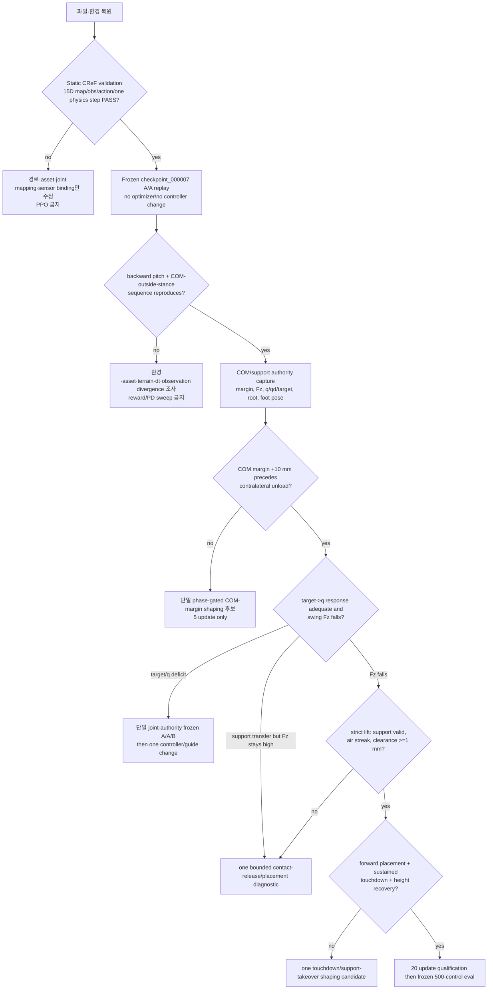

# CReF X2 locomotion — 진단·실패 원인·계측 권한 인수인계

## 목적과 증거 범위

이 문서는 대용량 replay, USD, checkpoint, W&B 원본을 새 컴퓨터로 모두 옮기지 못하는 상황에서 **무엇이 실제로 검증되었고, 무엇이 아직 가설인지**를 보존한다. 여기서 “CReF”는 두 계열을 구분해 사용한다.

1. **CReF2603/HDMI native teacher**: 원래 `unitree_rl_lab`의 일부를 HDMI/Isaac Lab에 재구성한 교사 환경이다. 가장 강한 원인 분석은 이 계열의 2k 정적-지지 재학습과 frozen replay에서 나왔다.
2. **후속 HDMI X2 lift/support-transfer 실험**: 같은 X2, 15D position action, SafeDirect/implicit PD 계열에서 이어진 발 들기·하중 이전 검증이다. 측정 방법과 실패 양상을 참고할 수 있지만, 이 결과를 CReF checkpoint의 직접 성능으로 주장하면 안 된다.

표기:

- **직접 증거**: 실제 Isaac/native run 또는 해당 run의 raw/replay 자료에서 측정됨.
- **구현 검증**: compile, CPU contract test, 또는 환경 생성/한 step 검증만 통과함.
- **가설/제안**: 다음 한 가지 실험으로 검증해야 하며, 보행 성공 근거가 아님.
- **미측정**: 값이 없거나 API 의미가 확정되지 않아 추정으로 채우면 안 됨.

결론부터 말하면, 현재 보존된 CReF evidence는 **안정적 전진 보행을 입증하지 않는다**. 가장 잘 검증된 병목은 `COM_TRANSFER_AND_FOOT_PLACEMENT`: COM이 지지발의 실제 sole polygon 안으로 옮겨지기 전에 지지 전환/접촉 변화가 일어나며, 발은 거의 제자리에 남고 pelvis/COM이 뒤로 빠져 pitch·height 붕괴로 이어진다는 것이다.

---

## 1. 현재까지 확인된 사실

| 항목 | 직접 증거 | 해석 / 금지할 과장 |
|---|---|---|
| CReF HDMI 환경 기동 | config/env 생성, 15 action mapping, policy forward, 1 physics step, finite reward/target이 통과했다. | **환경 진입 가능**만 증명한다. 긴 학습·보행 성공이 아니다. |
| 2k static-closure retrain | 15 env × 20 control × 7 update = 2,100 transition, `checkpoint_000007.pt` 생성. | S0 생존은 개선됐으나 stable forward gait는 미달이다. |
| 생존 개선 | 과거 S0 median 25 control에서 94.5 control로, longest 84에서 138 control로 증가. | 유효한 정지/지지 생존 개선이다. 보행 주기 획득으로 해석하면 안 된다. |
| 전진 | 완료 episode 평균 displacement **−0.41529 m**, command-tracking RMSE 0.50954. | command는 양의 전진이었지만 실제 pelvis/COM은 뒤로 갔다. 프레임 부호 오류 증거는 없다. |
| termination | 14/14 completed episode가 `lmo_base_height_below`. | height threshold 자체가 원인이라는 뜻은 아니다. frozen timeline은 이 종료가 실제 붕괴 뒤에 발생했음을 보인다. |
| frozen height failure | 15 env mean-action replay에서 14건 height termination, 1건 20 s timeout upright. | replay는 원래 stochastic 14 episode의 재현이 아니다. 다만 동일 checkpoint의 결정론적 실패 기제를 관찰한 강한 증거다. |
| contact 이벤트 | raw liftoff/touchdown은 L/R 248/200, 250/198이지만 qualified swing은 11/3, alternating qualified touchdown은 3, full-gait candidate 0. | raw contact edge는 chatter를 포함한다. raw count를 걸음 수로 쓰면 안 된다. |
| frozen stochastic swing | qualified unload/reload 41건(L/R 29/12), controlled swing 0, median rise 2.98 mm, max 10.47 mm, median 3 control. | 이는 지속 보행 스윙이 아니라 `SHORT_HOP`이다. touchdown 성공으로 세면 안 된다. |
| PPO 상태 | 7 update 동안 finite; KL 0.0511→0.0163, clip fraction 0.520→0.245, EV 0.0057→0.1229 (U5 peak 0.377), action std 약 0.20. | optimizer 폭주 증거는 없다. 7 update의 finite loss만으로 gait learning을 주장할 수 없다. |

### 1.1 가장 강한 failure timeline (CReF frozen deterministic replay)

14개의 height-failure episode 모두에서 순서가 일관됐다.

| 사건 | median control | median 상태 | 의미 |
|---|---:|---|---|
| 첫 posture decay | 100 | height 0.6607 m, pitch +0.2517 rad, body vx −0.1286 m/s | 아직 높이는 정상 범위이나 뒤로 기울고 뒤로 움직이기 시작 |
| 지속 height decay | 124.5 | height 0.6363 m, pitch +0.4809 rad, body vx −0.6273 m/s | posture 사건 뒤 약 24 control 후 height가 지속 하락 |
| physical fall criterion | 134.5 | height 0.5515 m, pitch +0.7685 rad, vz −0.7085 m/s | 실제 붕괴 상태 |
| `lmo_base_height_below` | 135.5 | height 0.5420 m, pitch +0.7915 rad, body vx −1.3469 m/s | 물리적 fall 후 0–1 control 지연으로 종료 |

따라서 0.55 m termination은 이 표본에서 “회복 가능한 squat을 너무 빨리 끊은” 것이 아니라, **피치 우세의 뒤로 넘어짐을 감지한 결과**다. `min_time=0.2`는 0.2초 지속 조건이 아니라 episode age가 10 control을 넘는 eligibility gate였고, 이 failure들은 127–190 control 후에 발생했다.

다음 반례도 기록해야 한다.

- terminal joint tracking error는 median 0.0287 rad, max 0.0311 rad로 0.15 rad failure cut보다 작았다.
- 최종 1초 700 sample은 모두 bilateral contact였고, contact transition은 없었다.
- controlled crouch, tracking sag, landing collapse 분류는 각각 0/14였고 `POSTURE_FALL`이 14/14였다.

즉 이 frozen population에서는 “무릎/PD가 target을 전혀 못 따라가서 높이가 꺼졌다”나 “한 발 착지 충격이 즉시 붕괴를 만들었다”는 주원인과 맞지 않는다.

---

## 2. COM·접촉·하중 이전의 인과 진단

### 2.1 CReF matched-state support diagnosis

동일 checkpoint, seed, initial physics state, q/qd, observation, recurrent state, previous action, command, policy output을 맞춘 뒤 control 0–14까지 bit-exact로 동일함을 확인한 matched-state 분석이 있다. 지지 영역은 foot-origin 원이나 사각 근사가 아니라 **actual ankle-roll collision sole의 70-vertex convex hull**로 계산했다.

| 조건 | 관찰 | 판정 |
|---|---|---|
| Natural frozen replay | 4,333 support-defined state 모두 individual stance polygon 밖. 가장 가까운 natural margin −44.0 mm, best stance margin −80.1 mm. | COM이 개별 지지발 영역으로 들어가지 못함. |
| COM-in-support diagnostic assist | hip-roll peak −0.0900 rad, ankle-roll +0.0648 rad; per-control max increment 0.0060/0.00432 rad. best margin +17.0 mm. | COM transfer가 제한된 action authority 안에서 물리적으로 가능함을 보임. 자연 policy의 no-op은 아님. |
| 위 assist 후 자연 partial unload | right load ratio 약 0.087–0.118, minimum right Fz 37.3 N. | 지지발 중심 COM 이동이 partial unloading을 만들 수 있음. 하지만 contact loss는 0/14. |
| + 15-control knee unload pulse | peak +0.0196 rad. minimum right Fz 32.0 N. | 더 unloading되지만 liftoff/controlled swing 0. |
| + 9-control tiny lift seed | knee +0.0336, hip pitch −0.0132, ankle pitch −0.0072 rad; combined knee max +0.0532 rad. min right Fz 14 N, median clearance gain 5.39 mm. | 여전히 contact loss·touchdown 0; `UNLOAD_ONLY`. |

**직접 판정:** `COM_TRANSFER_PRIMARY`. 자연 policy가 개별 stance sole 내 COM을 만들지 못했고, bounded COM assist가 partial unloading을 유발했다. 그 뒤 contact release와 swing은 여전히 미해결이다. assist는 survival도 줄였으므로 production controller 후보가 아니라 인과 probe다.

### 2.2 후속 lift/support-transfer 계열과의 일치

이 계열은 CReF와 동일 checkpoint가 아니지만, 이후의 X2 15D SafeDirect experiments에서도 같은 선후관계를 보였다.

- active left/right swing Fz가 각각 약 **201.45/215.71 N**이고 Fz<20 N은 1.34%/0.043%였다.
- intended stance share는 0.502/0.471 수준이었다.
- phase-selected sole rise mean 0.004–0.0115 mm는 physical clearance 상한이 아니라, 발이 계속 loaded 상태라 0 주변에 집중된 per-env-control 평균이다.
- V2 r1–r4까지 U5 stage gate에서 strict 1 mm physical lift 0, confirmed touchdown 0이었다. 좋은 r1도 reward 지급 표본 swing Fz가 약 154 N이었다.

이는 “lift reward가 작아서만” 발생한 문제가 아니라, **support transfer가 없는 상태에서 swing reward 또는 touchdown reward를 더 키운 bootstrapping deadlock**과 일치한다.

---

## 3. Reward·teacher/reference·PD에 관한 결론

### 3.1 CReF reward의 검증된 문제

2k CReF frozen diagnosis는 reward sign/frame exploit을 지지하지 않는다. moving command는 평균 +0.0917 m/s였고 body/world transform 오차는 4.30e-7 m/s 내였다. 그런데 early backward collapse에서도 여러 reward가 계속 양수였다.

- posture decay 전 mean total reward: +0.04395/control
- posture~height-decay 구간: +0.03359/control
- height-decay~termination: +0.00758/control
- posture decay 이후 92.4% control이 net-positive
- motion command와 actual vx가 +0.1224/−0.1286 m/s인 첫 posture decay에서도 linear velocity term이 +0.01544/control

긍정 신호를 유지한 대표 항목은 yaw tracking, foot spacing, body height, no-fly였다. 반면 CReF에 enabled된 positive air-time, foothold placement, positive clearance term은 없었다. `no-fly`는 single support를 보상하지만, clearance나 swing-foot placement를 명시하지 않는다. clearance는 당시 penalty 쪽이다.

**해석:** “backward velocity reward hack”은 직접 증거가 아니다. 더 정확한 표현은 **early backward collapse와 short-hop을 충분히 구분·감점하지 못하고, 실제 swing/foothold 목표가 부족한 reward geometry**다.

### 3.2 후속 reward hacking 방지에서 얻은 원칙

후속 X2 lift branch는 아래 원칙을 구현/CPU test했다. 이것은 설계 지침이며 CReF native gait success 근거가 아니다.

1. phase-local high-water mark만 reward한다. 같은 높이의 repeat rocking, Fz threshold chatter, common root rise는 반복 credit을 얻지 못하게 한다.
2. swing clearance는 terrain-relative clearance와 phase-start support-relative foot-height 중 작은 값을 쓴다.
   \[
   h=\min(c_{swing},\max(0,(z_{swing}-z_{support})-d_0)).
   \]
   따라서 robot 전체가 올라가는 common-root motion은 swing lift credit이 0이 된다.
3. early shaping은 `swing Fz<=10N`, 1 mm, touchdown을 **사전 조건으로 쓰지 않는다**. 이 값들은 strict success diagnostics로 유지한다.
4. forward/landing reward는 foot forward placement, sustained loading/height recovery를 함께 확인하기 전에는 gait success로 계산하지 않는다.

### 3.3 Teacher/reference 해석

CReF 원본 `unitree_rl_lab` teacher/policy 전체는 삭제되어 정확한 reference/teacher objective의 완전 복원은 불가능하다. HDMI CReF task는 부분 재구성이다.

- 보존된 native teacher task는 forward progress goal, one-shot goal/success pulse, top-down height scan, X2-safe terrain, terrain level update를 갖는다.
- **미복원:** original `policy_e` actor, CReF PPO variant, detailed foothold/landing quality, Student-A depth/distillation, exact late-0808 terrain reward.
- legacy RSL-RL checkpoint는 HDMI PPO checkpoint format과 actor/observation layout이 달라 `checkpoint_path`에 그대로 넣으면 안 된다.

그러므로 새 machine에서는 teacher/reference를 “정답 움직임”으로 가정해 강제 모방 학습부터 하지 말아야 한다. 먼저 frozen baseline의 command→target→q/qd→foot/COM/contact가 현재 asset·terrain에서 같은지 확인해야 한다.

### 3.4 PD/target authority

static CReF asset record의 implicit actuator 설정은 hip pitch/roll/yaw stiffness **600/450/450**, knee **400**, ankle **200**, hip/knee damping **5**, ankle damping **2**이며 effort limit은 hip/knee 120 Nm, ankle pitch/roll 36/24 Nm다. 이는 **그 run의 simulation configuration**이지 제조사 공식 권장값이나 hardware torque measurement가 아니다.

현재 증거는 다음을 구분한다.

| 항목 | 근거 | 판정 |
|---|---|---|
| target가 joint에 도달하지 않는 saturation | CReF frozen terminal tracking error가 작고, 후속 V4/V5 target–q gap도 hip~0.008, knee~0.032, ankle pitch~0.019 rad, software PD proxy saturation 0. | 주 병목으로 지지되지 않음. |
| reference가 target을 만들지 못함 | 후속 teacher/lift branch에서 swing knee reference–target gap 약 0.156 rad, reference reward는 q를 관찰할 뿐 target을 직접 쓰지 않음. | plausible/observed in that branch; CReF original 전체 reference에 일반화 금지. |
| delivered motor torque 여유 | implicit actuator `get_dof_actuation_forces()`가 0을 반환한 경우가 있었고 software PD proxy는 motor torque가 아니다. | **미측정**. “토크가 0” 또는 “토크 여유 충분”이라고 결론 내리면 안 됨. |
| target readback | post-step readback은 solver가 pre-step target을 소비했다는 증거가 아님. | **미확정**. |

PD gain·action scale을 먼저 sweep하는 것은 현 단계의 최소 원인 검증이 아니다. 측정된 causal blocker가 COM/stance geometry라서, controller tuning은 target gap 또는 q/qd response 문제를 먼저 별도 A/A/B로 입증한 뒤에만 다룬다.

---

## 4. Native measurement authority 표

| 측정값 | CReF/X2에서 가진 권한 | 사용 가능 범위 | 하지 말아야 할 해석 |
|---|---|---|---|
| q, qd, action/native target readback | runtime joint-name mapping/finite checks 및 traces로 기록 가능 | command→target→tracking gap, action row audit | readback을 motor torque나 solver consumption으로 부르지 않음 |
| foot pair contact Fz | CReF qualified detector가 canonical foot-pair force <=/>10 N 사용. 후속 frozen capture에서는 configured ankle-roll-link↔terrain pair impulse/dt가 Fz와 5 ms interval에서 수치 일치. | 해당 sensor pair의 force, edge detector, strict lift gate | 전체 sole normal load, material, point identity, CoP로 확대 해석 금지 |
| contact impulse | 후속 U5 frozen authority capture에서 normal impulse / 0.005 s와 same-step Fz 일치 (L/R MAE 약 3.95e-06/4.58e-06 N). | 동일 API·pair·dt query path가 revalidated된 경우 | CReF checkpoint에 자동으로 동일 authority가 있다고 가정하지 않음 |
| COM | CReF matched analysis에서 whole-body projected COM와 actual stance collision-sole polygon의 signed margin을 사용 | COM-in-support, lateral margin, sequence diagnosis | foot center 근사 또는 unequal Fz weighted center를 CoP ground truth로 부르지 않음 |
| CoP/contact point/material | persistent contact point, complete sole patch, material이 미확정 | 반드시 `NOT_MEASURED`/`NOT_AVAILABLE` | force-weighted foot center를 CoP로 라벨링하지 않음 |
| implicit actuator effort | delivered motor-only torque 및 native target solver consumption 미확정 | PD proxy는 software diagnostic으로만 사용 | proxy 또는 `get_dof_actuation_forces()==0`를 actual torque 0으로 해석하지 않음 |
| termination | terrain-relative height crossing·root/tilt/contact timeline 검증 가능 | actual physical fall vs threshold timing | `lmo_base_height_below`만 보고 causal joint failure로 결론 내리지 않음 |

후속 `x2_base_height_contact_authority_capture_20261116`은 특히 유용한 instrumentation reference다. frozen U5 20 env × 500 control × 4 substep에서 38개의 base-height terminal을 read-only로 기록했고, 37/38 crossing이 bilateral contact였다. terminal 10-control window에서 total Fz와 pair impulse가 함께 감소했지만, complete support patch/CoP/implicit drive effort는 미측정이었다. 이 결과는 **계측 패턴의 예시**이지 CReF frozen checkpoint의 직접 causal verdict가 아니다.

---

## 5. 보존된 핵심 파일과 checkpoint 지도

아래 path는 HDMI workspace root 기준이다. 새 컴퓨터에서는 먼저 파일 존재·SHA·runtime version을 확인하고, absolute path를 그대로 믿지 않는다.

| 용도 | 경로 | 상태 |
|---|---|---|
| CReF native task config | `cfg/task/X2/cref2603/teacher.yaml` | 보존, HDMI native task source |
| flat stage config | `cfg/task/X2/cref2603/stage0_flat.yaml` | 보존 |
| PPO config | `cfg/algo/cref2603_ppo.yaml` | 보존 |
| CReF command/goal logic | `active_adaptation/envs/mdp/commands/hdmi/cref2603.py` | 보존 |
| CReF terrain | `active_adaptation/envs/terrain/cref2603.py` | 보존 |
| basic static validator | `scripts/validate_cref2603.py` | 보존; one step/static validation only |
| CReF port/recovery contract | `reports/cref2603_hdmi_recovery.md` | 가장 먼저 읽을 문서 |
| recurrent PPO runner contract | `reports/cref_recurrent_isaac/CREF_RECURRENT_PPO_AUDIT.md` | synthetic/CPU runner evidence; native gait evidence 아님 |
| 2k run report | `outputs/isaac_cref_static_closure_2k_20261002/CREF_2K_RETRAIN_REPORT.md` | `PASS_S0_IMPROVED`, gait 미달 |
| 2k summary/validation | `outputs/isaac_cref_static_closure_2k_20261002/{summary,validation,contract,run_config}.json` | 수치·action mapping·PPO trend |
| primary CReF checkpoint | `outputs/isaac_cref_static_closure_2k_20261002/checkpoints/checkpoint_000007.pt` (6,678,075 B, SHA-256 `4dc2de7ea782074f619cb9bb9601c11e5567a541c35de19aaa5f130294757d60`) | HDMI-native, static-closure reference; 보행 성공 checkpoint 아님 |
| height failure audit | `outputs/cref_2k_frozen_height_audit_20261002_v7/CREF_FROZEN_HEIGHT_FAILURE_AUDIT.md` | frozen mean-action causal timeline |
| post-S0 combined audit | `outputs/isaac_cref_static_closure_2k_20261002/post_s0_diagnosis/CREF_2K_POST_S0_DIAGNOSIS.md` | reward/COM/swing/PPO separation |
| matched COM diagnostic | `outputs/isaac_cref_static_closure_2k_20261002/matched_state_diagnosis/CREF_MATCHED_STATE_COM_UNLOADING_DIAGNOSIS.md` | primary causal COM evidence |
| terrain 15k validation | `reports/cref2603_isaac_terrain_15000.md` and `outputs/isaac_cref_15000_terrain/checkpoints/checkpoint_step_000015000.pt` (4,595,002 B) | finite-run/checkpoint schedule validation, gait convergence 미입증 |
| legacy recovery index | `recovery/cref2603/README.md`, `recovery/cref2603/manifest.json` | partial recovery and file provenance |
| later lift/contact root-cause note | `x2_contact_release_authority_v2_20261122/LOW_LIFT_ROOT_CAUSE_AND_V6.md` | same-platform successor evidence, CReF direct result 아님 |
| later bounded candidates | `x2_contact_release_authority_v2_20261122/runs/contact_release_v2_01/RESULT_ANALYSIS.md` | U5 1mm gate all fail; useful negative evidence |
| native contact authority reference | `x2_base_height_contact_authority_capture_20261116/{FINAL_REPORT.md,final_verdict.json}` | measurement pipeline reference, not CReF causal result |

### 5.1 Observation / checkpoint compatibility warning

`reports/cref2603_hdmi_recovery.md` documents one HDMI-native observation assembly as actor policy 803D and critic privileged group 809D (combined critic input 1612D). In contrast, the `checkpoint_000007.pt` static-closure adapter contract reports actor proprio 85D plus depth `[1,48,64]`, critic input 802D, and a `CrefActorCritic` wrapper. These may be different runner-layer representations, but that has **not** been proven as a resume-compatible identity.

Before any load or training continuation, the new machine must print checkpoint tensor keys/shapes, actor/critic observation layout, normalization buffers, recurrent state layout, action order, and optimizer configuration. Treat a mismatch as a conversion/reconstruction task, not as a recoverable `strict=False` load.

### 5.2 legacy artifacts that cannot be treated as HDMI inputs

| Artifact | 상태 |
|---|---|
| legacy `model_5238.pt`, `model_3500.pt` | `recovery/cref2603/README.md`는 과거 W&B recovery에 존재했다고 기록하지만, **현재 workspace의 `recovery/cref2603/wandb/`와 해당 model 파일은 존재하지 않는다**. 새 machine에 있다고 가정하지 말고, 별도 위치에서 찾으면 SHA와 original config를 먼저 기록한다. 설령 확보해도 original CReF/RSL-RL actor keys·observation layout이므로 HDMI PPO state dict에 직접 load 금지. |
| original June 15 Task2 `model_500.pt` | 로컬 및 접근 가능한 W&B에서 발견되지 않음. **unavailable**. |
| full original `unitree_rl_lab` tree | 삭제됨. **unavailable**. |
| `cref2603_policy.py`, `cref2603_ppo.py`, `cref2603_0722.py` full originals | 복구되지 않음. VS Code local-history snapshot 일부만 존재. |
| original detailed foothold/landing teacher machinery 및 Student-A depth/distillation | 부분/정확 복원이 아님. reconstructed HDMI task의 결과와 동일하다고 주장 금지. |
| full raw trajectory/contact replay for every historical run | 모두 보존되지 않음. aggregate 2k rows와 later frozen read-only replay를 서로 동일 episode로 취급 금지. |

---

## 6. 새 컴퓨터에서의 안전한 다음 작업 결정 트리

### 6.1 반드시 지킬 gating 순서

1. **G0 — runtime authority:** action order, q0/scales, terrain-relative frame, sensor body/pair, physics/control timebase, reset generation을 확인한다. 이 단계가 불명확하면 PPO를 시작하지 않는다.
2. **G1 — frozen reproduction:** `checkpoint_000007.pt`로 A/A seeded/deterministic repeat을 수행해 pitch/height/COM sequence를 확인한다. 새 asset·friction·terrain이 다르면 old numbers와 직접 비교하지 않는다.
3. **G2 — support transfer:** individual stance sole signed margin, stance share, swing Fz의 순서를 기록한다. `COM margin >+10 mm`가 최소 세 control 유지되고 swing load ratio가 내려가는지를 본다.
4. **G3 — physical lift:** root rise가 아닌 terrain-relative/support-relative sole clearance, support contact, 3-control air streak을 함께 기록한다. 1 mm가 첫 success marker이고 5 mm는 다음 marker다.
5. **G4 — touchdown:** native contact edge를 anchor로 하여 foot pose/velocity, Fz/impulse, target-q, COM margin, root height를 전후 substep에 정렬한다. delayed qualified ledger를 pre-impact “normal landing”으로 쓰지 않는다.
6. **G5 — takeover/recovery:** new foot loading, previous stance unload, root height recovery, positive body/world displacement와 heading을 동시에 확인한다. 단일 touchdown 또는 mean reward 증가만으로 gait pass 선언 금지.

### 6.2 최소 변경 원칙

- 한 candidate에는 reward, PD, action scale, guide, contact threshold, termination을 **동시에 하나 이상** 바꾸지 않는다.
- CReF 2k diagnosis에서 가장 먼저 검증할 단일 변경은 **phase-gated signed COM-margin progress**다. contralateral contact loss 후에는 끄고, high-water/monotone form으로 반복 rocking을 보상하지 않는다.
- 그 intervention이 `margin >+10 mm → swing load 감소`를 만들지 못하면 knee/ankle torque·stiffness를 바꾸지 않는다. 먼저 geometry/phase/sign 측정을 재검증한다.
- `F_swing <=10 N`, 1 mm lift, touchdown은 초기 reward precondition이 아니라 strict diagnostic gate로 분리한다. 아직 달성 불가능한 조건을 reward gate에 넣으면 gradient가 0이 되는 bootstrap loop가 생긴다.
- candidate A/A/B는 Frozen prestate와 동일 command/seed를 쓰고, B에서 오직 한 bounded intervention만 추가한다. delivered effort·CoP가 미측정이면 그 결과로 torque/COP theory를 확정하지 않는다.

---

## 7. 새 run에서 반드시 남길 로그

다음 열은 control ID, physics substep ID, env ID, reset generation 및 pre/post physics 표시와 함께 저장한다. 값이 불가능하면 0이나 proxy로 채우지 말고 `NOT_MEASURED`로 schema에 남긴다.

| 범주 | 필수 로그 |
|---|---|
| action authority | actor raw 15D, effective/guarded action, 31D/native target, q/qd, reference-target-q를 separate columns |
| contact | left/right configured pair Fz, pair identity, normal/friction impulse와 dt query scale, contact onset/release, air streak, buffer saturation |
| kinematics | foot world pose/quaternion, terrain-relative clearance, support-relative rise, vertical/lateral/tangential velocity, root/torso pose/velocity |
| balance | whole-body COM position/velocity, signed COM-to-actual-sole-polygon margin, chosen stance side, stance share/swing share, support region provenance |
| reward | raw, weighted, dt-scaled each term; phase/gate values; high-water state; included return. post-hoc final mean만 남기지 않는다. |
| learning | advantage/return distribution, KL, clip fraction, actor/critic/log_std gradient, EV, action RMS/P95/P99 per joint, checkpoint/source/asset SHA |
| safety | target-rate/position/velocity/effort headroom, hardstop time, termination reason, data flush and GPU cleanup receipt |

W&B에는 위의 aggregate와 함께 **left/right 분리** 값을 보낸다. 다만 W&B scalar를 raw physical proof로 쓰지 말고, 원본 control/substep CSV와 checkpoint/asset/config SHA를 같은 run directory에 둔다.

---

## 8. 작업 시작 전 한 문장 요약

새 컴퓨터에서 다음 질문을 먼저 답해야 한다.

> 동일 CReF frozen checkpoint가 현재 Isaac asset/terrain에서, `COM이 individual stance sole 바깥 → partial/unloading 실패 → 발 고정·pelvis 후방 이동 → pitch 상승 → base-height collapse` 순서를 다시 보이는가?

답이 예라면 다음 PPO 장기 학습이 아니라 **COM-margin authority를 측정한 하나의 frozen A/A/B와 그 뒤 5-update candidate**가 적절하다. 답이 아니면 새 환경 이식 차이부터 해결해야 하며, 기존 reward/PD/teacher scale을 반복 조정해서는 안 된다.

## 9. 원본 근거 목록

- `reports/cref2603_hdmi_recovery.md`
- `reports/cref_recurrent_isaac/CREF_RECURRENT_PPO_AUDIT.md`
- `outputs/isaac_cref_static_closure_2k_20261002/CREF_2K_RETRAIN_REPORT.md`
- `outputs/isaac_cref_static_closure_2k_20261002/summary.json`
- `outputs/cref_2k_frozen_height_audit_20261002_v7/CREF_FROZEN_HEIGHT_FAILURE_AUDIT.md`
- `outputs/isaac_cref_static_closure_2k_20261002/post_s0_diagnosis/CREF_2K_POST_S0_DIAGNOSIS.md`
- `outputs/isaac_cref_static_closure_2k_20261002/matched_state_diagnosis/CREF_MATCHED_STATE_COM_UNLOADING_DIAGNOSIS.md`
- `recovery/cref2603/{README.md,manifest.json}`
- `x2_contact_release_authority_v2_20261122/{LOW_LIFT_ROOT_CAUSE_AND_V6.md,runs/contact_release_v2_01/RESULT_ANALYSIS.md}`
- `x2_base_height_contact_authority_capture_20261116/{FINAL_REPORT.md,final_verdict.json}`
