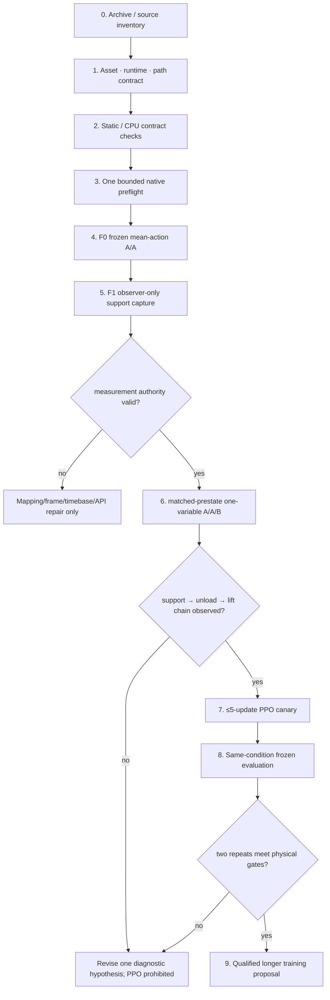

# X2 CReF locomotion — 새 컴퓨터 실험 재개 플레이북

## 이 문서의 역할과 한계

이 문서는 대용량 X2 archive를 아직 받지 못했거나, archive를 복원한 뒤 새 장비에서 **무엇을 어떤 순서로 확인해야 하는지**를 고정한 실행 계획이다. 작성 시점에는 이 문서의 명령으로 Isaac Sim, PhysX, frozen 평가, PPO optimizer를 실행하지 않았다.

따라서 다음 둘을 엄격히 분리한다.

| 상태 | 이 문서가 주장하는 범위 |
|---|---|
| 문서·파일 인계 | 보존된 소스, 설정, 결과 보고서, runtime pin, checkpoint 경로를 새 장비에서 검토할 수 있다. |
| native 재현 | 새 장비의 GPU, Isaac, asset, contact API, action mapping, checkpoint가 실제로 같은 물리 상태를 만든다는 별도 증거가 필요하다. |
| 보행 성공 | 현재 보존 자료만으로는 안정적 전진 보행을 입증하지 않는다. F0/F1/F2 및 이후 physical gate를 새 장비에서 통과해야 한다. |

특히 다음 네 계열을 서로 바꾸어 부르면 안 된다.

1. HDMI MLP PPO / LMO 계열
2. HDMI에서 부분 재구성한 `CReF2603` privileged teacher 계열
3. 외부 `RoboJuDo-Plus` recurrent CReF 계열
4. 역사적 `walk_*`, `x2_*`, V9–V18 successor 계열

checkpoint 파일명, `PASS`, Viser 화면, reward 상승, hard safety event 0은 이들 사이의 호환성이나 보행 성공을 뜻하지 않는다.

---

## 1. 새 장비의 고정된 진행 순서

아래 순서를 건너뛰지 않는다. 각 단계의 output은 새 run directory에 immutable하게 저장한다. 기존 archive의 `runs/`, `frozen_runs/`, checkpoint와 보고서를 덮어쓰지 않는다.



### 1.1 Gate 표

| Gate | 질문 | 최소 합격 근거 | 불합격 시 허용되는 작업 |
|---|---|---|---|
| G0 | 파일과 실행 정체성이 있는가? | source/config/asset/checkpoint/normalizer/PD profile SHA 또는 명시적 `MISSING` 목록 | 다운로드·경로·asset 복원만 수행 |
| G1 | runtime과 articulation이 맞는가? | Python/Isaac/asset variant, 31D joint name/index, 15D action route, dt/decimation, sensor body/pair 일치 | import·path·mapping만 수정 |
| G2 | frozen baseline이 재현되는가? | F0 A/A에서 seed, initial contract, mean action, source/asset/checkpoint identity와 summary 분포가 비교 가능 | reward/PD/scale 변경 금지 |
| G3 | 물리 측정값이 권위 있는가? | Fz pair identity·단위·freshness, COM frame, pre/post timestamp, reset generation, safety flush 확인 | collector/mapping/timebase만 수정 |
| G4 | 실제 지지 전환이 있는가? | stance-side COM/support margin 개선이 swing Fz 감소보다 먼저 같은 side·generation에서 관측 | 하나의 bounded lateral/support probe만 설계 |
| G5 | 물리 lift가 있는가? | valid stance + swing unload/release + terrain-relative clearance >= 1 mm가 같은 event에 존재 | joint authority 또는 contact-release probe 하나만 실행 |
| G6 | 착지와 회복이 있는가? | touchdown 후 새 발 load acceptance, root-height recovery, forward displacement가 같은 landing ledger에서 유지 | takeover/placement 후보 하나만 설계 |
| G7 | PPO를 시작해도 되는가? | F0 대비 height/fall 악화 없음, G4–G6 순서가 두 frozen repeat에서 유지 | 처음에는 최대 5 update canary만 허용 |

`NOT_RUN`은 아직 실행하지 않았다는 뜻이며 0이나 실패와 다르다. `NOT_MEASURED`는 API/로그 권한이 없는 값이고 추정값으로 채우면 안 된다. `NOT_COMPARABLE`은 side, prestate, phase, population, timebase가 달라 수치 비교가 무효라는 뜻이다.

---

## 2. 첫날: inventory와 복원본/작업 사본 분리

### 2.1 두 가지 인계 수준

**문서만 받은 경우**에는 이 handoff의 논리와 실험 순서를 검토할 수 있을 뿐, 원본 X2 simulator를 실행하면 안 된다. CReF source, USD/URDF/mesh, checkpoint, Isaac runtime 중 어느 것이 있는지 먼저 `MISSING`으로 기록한다.

**대형 archive까지 복원한 경우**에도 `restored/`와 `work/`를 분리한다. 원본 복원본은 hash/receipt 검증용으로 남기고, 새 path binding 또는 새 결과는 work copy에만 쓴다.

```bash
# 예시 변수. 실제 mount와 용량에 맞게 바꾼다.
export X2_ARCHIVE="$HOME/x2-locomotion-archive"
export X2_TRANSFER="$HOME/x2-transfer-data"
export X2_RESTORED="$X2_TRANSFER/base"
export X2_WORK="$X2_TRANSFER/working"

mkdir -p "$X2_TRANSFER"
df -h "$X2_ARCHIVE" "$X2_TRANSFER"

# archive가 정상 복원됐는지 먼저 read-only 검사한다.
python3 "$X2_ARCHIVE/handoff_tools/check_restored.py" \
  --restored-root "$X2_RESTORED" \
  --profile v18 \
  --report "$X2_TRANSFER/HANDOFF_CHECK_NEW_PC_01.json"

# 검사 결과가 PASS 범위인지 확인한 뒤에만 work copy를 만든다.
mkdir -p "$X2_WORK"
cp -a --reflink=auto \
  "$X2_RESTORED/workspace" "$X2_RESTORED/external" "$X2_WORK/"
```

위 `cp`는 filesystem이 reflink를 지원하지 않으면 실제 대용량 복사가 된다. 여유 공간을 먼저 확인한다. 불완전하게 복원된 목적지에 restore를 재실행해 덮어쓰지 않으며, 재시도는 새 빈 destination에 한다.

### 2.2 새 `NEW_HOST_INVENTORY.md`에 적을 필수 항목

아래 표를 빈 값으로 시작해도 되지만, 추측으로 `PASS`를 채우지 않는다.

| 범주 | 반드시 기록할 값 |
|---|---|
| host | OS/kernel, CPU/RAM, filesystem free space, `nvidia-smi` 출력, GPU model/VRAM, driver/CUDA visibility |
| interpreter | absolute Python path, `python --version`, Conda env name/prefix, `sys.path` 앞부분 |
| engine | Isaac Sim version, Kit/engine setup script, IsaacLab source path and Git commit, editable install paths |
| source | HDMI root, V14/V17/V18 roots, CReF task source, RoboJuDo source의 실제 SHA/dirty state |
| asset | `x2.py` asset root, robot variant, URDF/USD/mesh resolved path, asset/meta SHA, collision/foot link names |
| control | 31 joint runtime order, 15D policy joint order, SafeDirect writer, PD profile, position/velocity/effort/target-rate guards |
| time | physics dt, control dt, decimation, action application 시점, observation pre/post physics provenance |
| sensor | left/right contact body and terrain pair, Fz units, contact buffer layout/saturation, COM source/frame, terrain height source |
| checkpoint | file path/SHA, parent lineage, model/observation/action dimensions, normalizer, optimizer/resume sidecars |
| missing | unavailable source bytes, assets, checkpoints, raw traces, tokens/licences를 `MISSING`으로 명시 |

원래 환경 기록의 기준은 Python 3.11.15, Isaac Sim Python package 5.1.0.0, torch 2.7.0+cu128, torchrl/tensordict 0.7.0, 로컬 IsaacLab 2.2.0 commit `46dff135f44683f031edf346e544fcfd8456b2bb`이다. 이는 새 장비에서 동일하게 설치됐다는 증거가 아니다. Python 3.10 + Isaac Sim 4.5 계열, Python 3.11 + Isaac Sim 5.1 계열, 다른 `env_isaacsim`/`genie_sim` 환경을 섞지 않는다.

### 2.3 반드시 경계해야 하는 path 문제

- `active_adaptation/assets/x2.py`의 `X2_ASSET_ROOT`는 환경변수가 아니라 소스 상수였으므로 `export X2_ASSET_ROOT=...`만으로 해결되지 않는다.
- V18의 `frozen_baseline_pd_profile.json`은 V17 absolute path를 참조한다. 이 path와 V14 checkpoint lineage가 work copy에 모두 있어야 한다.
- `IsaacLab`과 `Agibot-x2_stand_train/IsaacLab`은 같은 것으로 합치면 안 된다. 후자에는 local modification이 있었고, 과거 launcher가 직접 `PYTHONPATH`에 넣었다.
- `15D → 31D` mapping은 joint name/index로만 고정한다. alphabetic sort, URDF 순서 추측, left/right mirror 추측으로 재작성하지 않는다.
- 경로 문자열을 프로젝트 전체에 일괄 치환하지 않는다. config, runner, `sys.path`, asset resolver, USD sublayer, symlink를 개별적으로 확인한다.

---

## 3. G0–G1: runtime/asset/static contract

### 3.1 우선 읽을 원본 문서

archive 또는 work copy에서 아래 순서로 읽는다.

```text
docs/NEW_COMPUTER_SETUP_KO.md
docs/runtime/ENVIRONMENT_KO.md
docs/runtime/PORTING_KO.md
docs/runtime/ABSOLUTE_PATH_REFERENCES.json
docs/methods/METHODS_KO.md
docs/methods/TRAINING_AND_RESUME_KO.md
docs/results/RESULTS_AND_LIMITATIONS_KO.md
docs/results/LATEST_R33_R34_REVIEW.json
```

다음 source/receipt는 V18의 frozen sequence를 시작할 때 필요하다.

```text
workspace/HDMI/x2_v18_support_first_method_redesign_20261123/
  README.md
  METHOD_REDESIGN.md
  CANDIDATES.json
  run_static_checks.py
  run_frozen_support_eval.py
  run_frozen_lateral_transfer_eval.py
  frozen_baseline_pd_profile.json
  frozen_runtime_source/

workspace/HDMI/x2_v14_policy_prior_window_20261122/
  runs/v14_policy_prior_window_02/branches/c2_moderate_authority_u10/
  train/checkpoints/walk_update_0010.pt
```

V18 reference baseline checkpoint의 SHA-256은 다음 값이다.

```text
65845635fdc8aa7e870fd2d252d889477083ef18f41d203a4f63a46fb6c0578b
```

이 checkpoint는 최근 V18 frozen diagnostic의 연결 기준일 뿐, 가장 좋은 보행 모델이나 PPO resume parent로 자동 승인된 모델이 아니다.

### 3.2 static/CPU 검사

다음은 Python source contract를 검사하는 예시다. `run_static_checks.py`는 dependency-free support-first contract test를 실행하지만, 그 PASS를 native physics/asset PASS로 부르면 안 된다.

```bash
export HDMI_ROOT="$X2_WORK/workspace/HDMI"
export V18="$HDMI_ROOT/x2_v18_support_first_method_redesign_20261123"
export PYTHON="/absolute/path/to/the/selected/python3.11"

cd "$V18"
"$PYTHON" -m py_compile support_first_contract.py
"$PYTHON" run_static_checks.py
```

static/CPU 단계에서 확인할 내용:

1. input checkpoint SHA가 manifest와 일치한다.
2. config의 phase clock은 `90 controls`, left start `0`, right start `45`, active window `29`, control dt `0.02 s`, period `1.8 s`로 **모든 phase consumer가 같은 정의**를 쓴다.
3. 31 joints, 32 bodies, 15 policy actions라는 runtime assertion이 source와 config에서 일관된다.
4. SafeDirectJointPosition이 native target의 유일한 writer라는 계약을 source로 확인한다.
5. frozen eval에서는 optimizer steps=0, mean action, `log_std` checkpoint restoration, reward observed-only, action/target modification=0이라는 scope가 적혀야 한다.
6. static import failure, YAML parse failure, missing path, checkpoint SHA mismatch는 PPO나 native action 수정으로 고치지 않는다.

`scripts/validate_cref2603.py` 또는 환경 생성/one physics step 검사는 정적 검사와 다르다. 실제 simulator가 열리는 step이면 GPU/PhysX/asset load와 safety preflight를 포함한 native operation으로 취급하고, 별도 one-shot 예산과 cleanup receipt를 먼저 만든다.

---

## 4. G2: native preflight 후 F0 frozen A/A

### 4.1 F0의 목적

F0은 새 reward나 controller를 시험하는 단계가 아니다. 동일한 frozen policy를 mean action으로 실행하여 새 장비의 runtime이 다음을 동시에 보존하는지 보는 측정 단계다.

- checkpoint state/normalizer/source/asset/PD identity
- 15D action → SafeDirect → 31D native target route
- physics `0.005 s`, control `0.02 s`, decimation 4
- 32 env, 180 controls, seed 916406
- optimizer 0, action/target modification 0, automatic retry 0
- target/q/qd, contact Fz/pair, foot pose, COM/root, terminal/reset, cleanup logging

원본 V18 F0/F1 manifest의 two-repeat setting은 32 env × 180 controls이며, output은 `frozen_runs/<run-id>` 아래 immutable하게 생성된다. 이미 같은 run-id가 있으면 overwrite하지 말고 새 ID를 쓴다.

### 4.2 실행 전에 작성할 preflight receipt

`F0_PREFLIGHT_NEW_HOST.json`에는 아래를 넣는다.

```json
{
  "checkpoint_sha256": "...",
  "source_sha256": {"runner": "...", "collector": "..."},
  "asset_sha256": "...",
  "python_executable": "...",
  "isaac_version": "...",
  "envs": 32,
  "controls": 180,
  "physics_dt_s": 0.005,
  "control_dt_s": 0.02,
  "optimizer_steps": 0,
  "action_target_modifications": 0,
  "automatic_retries": 0,
  "mean_action": true,
  "guard_unchanged": true,
  "native_limits_unchanged": true,
  "output_dir": "new immutable path",
  "gpu_conflict_check": "PASS or exact blocking PID",
  "cleanup_plan": "flush trace then close app/process"
}
```

`source_sha256`, `asset_sha256`, GPU status가 비어 있거나 contact collector가 old source를 import하면 실행을 보류한다. 과거 report의 `cuda_available: true`나 과거 PID는 새 장비 preflight의 증거가 아니다.

### 4.3 승인된 one-shot에서만 사용할 command pattern

아래 패턴은 native physics를 실제로 진행한다. 새 장비의 absolute path를 rebinding하고, preflight가 통과하고, 실행 예산이 승인된 후에만 사용한다. 이 문서 작성 중에는 실행하지 않았다.

```bash
export HDMI_ROOT="$X2_WORK/workspace/HDMI"
export V18="$HDMI_ROOT/x2_v18_support_first_method_redesign_20261123"
export PYTHON="/absolute/path/to/python3.11"

# A repeat: immutable frozen mean-action capture
"$PYTHON" "$V18/run_frozen_support_eval.py" \
  --run-id "newhost_f0_repeat_a" \
  --controls 180 \
  --seed 916406

# B repeat: same contract, distinct output path
"$PYTHON" "$V18/run_frozen_support_eval.py" \
  --run-id "newhost_f0_repeat_b" \
  --controls 180 \
  --seed 916406
```

새 장비에서 script에 하드코딩된 `/home/fain/...` interpreter/path가 남아 있으면 이를 그대로 실행하지 않는다. work copy에서 source pin을 기록하고 `F0_PREFLIGHT_NEW_HOST.json`을 갱신한 뒤, 해당 source change를 별도 new-host derivative로 명시한다. path portability fix는 action/reward/PD/native-limit 변경과 같은 run에 섞지 않는다.

### 4.4 F0 A/A pass/fail 기준

**A/A에서 비교 가능한 항목**

| 계층 | 비교할 값 |
|---|---|
| identity | checkpoint/source/asset/PD SHA, env count, seed, mean action, clock definition |
| action | raw 15D action, effective/guarded action, approved 31D target, target rate projection 여부 |
| kinematics | q/qd, foot pose/quaternion, foot linear/angular velocity, root/torso state, whole-body COM |
| contact | exact left/right body-pair identity, Fz/impulse source, contact edge, buffer saturation, pre/post step stamps |
| lifecycle | env ID, generation, control, substep, reset/terminal chronology, data flush, process/GPU cleanup |
| physical outcome | root height, pitch/roll/rate, stance geometry margin, terminal reason, forward displacement |

**A/A pass**는 same source/runtime에서 exact bit-identical physics를 무조건 요구하지 않는다. 대신 action route와 instrument authority가 같고, physical outcome distribution 및 terminal/trace chronology가 comparable해야 한다. stochastic action, GPU nondeterminism, different reset state를 A/A pass로 위장하지 않는다.

**F0 failure**의 예:

- action joint order가 바뀜
- post-step target readback만 있고 solver-consumption 또는 pre/post stamp가 없음
- contact Fz가 reset 직후 0인지 stale인지 구분 불가
- asset/collision/terrain hash가 original과 다름
- same seed인데 output dir가 old result를 재사용함
- failures를 auto retry로 숨김

이 경우 F1/F2/PPO를 시작하지 않는다.

---

## 5. G3: F1 observer-only measurement authority

F1은 actor, reward, PD, native limits, guard, asset, target writer를 바꾸지 않는 read-only capture다. 목적은 **무엇을 실제 물리값으로 말할 수 있는지**를 확정하는 것이다.

### 5.1 control/substep schema

모든 record에는 아래 identity columns가 필요하다.

```text
run_id, source_sha, asset_sha, checkpoint_sha,
env_id, episode_generation, control_id, physics_substep,
physics_time_s, pre_or_post_physics, planned_swing_side,
chosen_stance_side, reset_flag, terminal_flag, terminal_reason
```

그 뒤 아래 값을 한 row schema에서 분리 기록한다.

| 범주 | 기록값 |
|---|---|
| action/target | actor raw 15D, policy mean/effective action, guard projection, approved 31D native target, reference→target→q gap |
| joints | joint names/index map, q, qd, target, rate/position/velocity/effort headroom, **software PD proxy와 native effort를 별 칼럼** |
| feet | left/right world pose/quaternion, terrain-relative sole clearance, support-relative rise, vertical/lateral/tangential velocity, angular velocity |
| contact | contact body/pair IDs, contact state, normal/friction impulse, Fz conversion dt, buffer count/capacity/saturation, onset/release |
| balance | whole-body COM position/velocity/frame, root/torso orientation/rate, stance share, support sole-polygon signed margin |
| landing | landing ID, side, onset, qualified, confirmation, reward payment, terminal/reset linkage |
| reward | raw quantity, gate, weighted term, dt treatment, clipping, included return, phase high-water/frontier state |

### 5.2 authority rules

1. **Fz**: configured foot-body ↔ terrain pair identity, units, freshness, interval을 확인한 Fz만 load partition에 사용한다. Fz=0이 reset/missing buffer/real release 중 무엇인지 구분한다.
2. **impulse**: normal impulse / actual physics dt가 same-step Fz와 일관되는지 검증한다. API가 force를 주는데 다시 dt로 나누거나, impulse인데 force처럼 읽지 않는다.
3. **CoP**: persistent contact point와 complete wrench/moment/sole patch가 없으면 `NOT_MEASURED`다. unequal Fz의 foot-center weighted average를 actual CoP로 라벨링하지 않는다.
4. **COM**: whole-body mass-weighted source와 coordinate frame을 기록한다. root/pelvis 위치를 COM으로 대신 쓰지 않는다.
5. **torque**: `get_dof_actuation_forces()==0` 또는 software PD equation은 actual motor-only torque가 아니다. actuator effort semantics가 검증될 때까지 `NOT_MEASURED`다.
6. **target**: post-step target readback은 next pre-step solver consumption 증거가 아니다. target writer, timestamp, applied/approved target을 분리한다.
7. **support**: individual stance foot actual collision-sole polygon과 COM projected margin을 쓴다. foot origin circle/rectangle 근사만 있으면 approximation이라고 표기한다.

### 5.3 F1의 의사결정

F1의 핵심 질문은 다음이다.

> 같은 phase/side/control에서 `COM/support movement → stance share increase → swing Fz decrease/release → terrain-relative lift` 순서가 관찰되는가?

자연 policy가 이를 만들지 못해도 실패가 아니다. 그것은 F2 single intervention의 출발점이 된다. 반대로 sensor authority가 없는 상태에서 Fz/CoP/effort 결론을 내리면 F2 candidate 자체가 잘못된 원인을 겨냥할 수 있다.

---

## 6. G4–G6: matched-prestate 단일 A/A/B 원인 실험

### 6.1 선택 가능한 첫 B intervention은 하나뿐

F0/F1 이후에도 chain이 막히면 다음 셋 중 하나를 선택한다. 같은 B arm에서 둘 이상을 합치지 않는다.

| B 후보 | 언제 선택할지 | 허용 변화 | 성공 판정 |
|---|---|---|---|
| B1: bounded lateral support shift | COM이 individual stance sole 밖에 있고 swing Fz가 high인 경우 | validated sign/Jacobian에 따른 stance hip-roll/ankle-roll/waist-roll의 작은, phase-gated target only | same prestate에서 stance share 증가와 swing Fz 감소가 root-height/fall 악화 없이 발생 |
| B2: knee target authority probe | reference→approved target gap이 크고 q tracking보다 target 생성 부족이 먼저인 경우 | swing knee target authority만, existing SafeDirect/limits 내에서 | target gap이 줄고 q/foot response가 생기는지; support transfer를 자동 주장하지 않음 |
| B3: contact-release/placement probe | support transfer는 보이나 swing foot가 계속 loaded인 경우 | one bounded contact-release 또는 foot placement diagnostic | Fz release와 clearance가 validity gate 안에서 생기는지; touchdown/forward reward는 변경하지 않음 |

reward, PD gain, action scale, teacher authority, guard, native limit, friction/collision, termination threshold를 B candidate에 동시에 더하면 원인 분리가 무너진다.

### 6.2 APA / lateral support의 수식과 제한

support side sign을 \(s\in\{-1,+1\}\), half-step start를 \(t_0\)로 둔다. 다음은 **실제 CoP가 아니라**, verified COM/stance geometry로 계산하는 potential example이다.

\[
\Delta y_s=s(y_{COM}(t)-y_{COM}(t_0)),\qquad
\Delta v_s=s(\dot y_{COM}(t)-\dot y_{COM}(t_0)).
\]

support-side lateral target은 joint별 CoP가 아니라 validated task-space Jacobian의 damped least-squares mapping으로만 만든다.

\[
\dot y^*=-k_p e_{support}-k_d\dot e_{support},\qquad
\Delta q=\operatorname{clip}\big[J_y^T(J_yJ_y^T+\lambda^2I)^{-1}\dot y^*\Delta t\big].
\]

여기서 \(J_y\)의 sign/order는 native q/target readback과 A/A test에서 먼저 검증해야 한다. `clip` 뒤에도 existing SafeDirect, target-rate guard, position/velocity/effort limit이 최종 gate를 담당한다. Fz-weighted foot center를 CoP라고 놓고 inverse dynamics를 만들면 안 된다.

### 6.3 F2 lateral command pattern

아래도 native physics를 실제 실행하는 pattern이다. F0/F1 authority와 one-shot approval 후에만 쓴다.

```bash
# A: baseline arm, B: only bounded lateral action arm
"$PYTHON" "$V18/run_frozen_lateral_transfer_eval.py" \
  --run-id "newhost_f2_baseline_a" \
  --mode baseline --envs 32 --controls 180 --seed 916406 \
  --plan "$V18/LATERAL_TRANSFER_PLAN.json"

"$PYTHON" "$V18/run_frozen_lateral_transfer_eval.py" \
  --run-id "newhost_f2_lateral_b" \
  --mode lateral --envs 32 --controls 180 --seed 916406 \
  --plan "$V18/LATERAL_TRANSFER_PLAN.json"
```

`--mode lateral`은 observation-only baseline과 다르게 15D action을 bounded하게 바꾸는 intervention이다. F2 output을 F0 observer-only result와 섞어 “same unchanged controller”라고 부르지 않는다. original runner는 `envs`를 32 또는 64, `controls`를 45–500으로 제한한다. 새 장비에서 runner/source path를 port한 경우 허용 범위 및 plan schema를 preflight receipt에 다시 기록한다.

### 6.4 matched prestate contract

단순 동일 seed는 full PhysX state equality의 충분조건이 아니다. A/B 이전에 다음을 비교한다.

```text
env_id, generation, control, substep,
root pose/velocity, q/qd, contact state,
observation tensor/hash, previous action,
recurrent hidden state (if any), command,
RNG state, policy output before B,
asset/terrain/source/checkpoint identity
```

정의한 common prefix가 동일하지 않으면 `NOT_COMPARABLE`로 남기고 B 효과 크기를 주장하지 않는다. A/A repeat variance가 B effect보다 크다면 B는 보류한다.

### 6.5 physical success chain

같은 `episode_generation`, `landing_id`, foot side의 chronology 안에서 다음 순서가 확인되어야 한다.

\[
\text{valid stance contact/load}
\rightarrow \text{COM/support preparation}
\rightarrow \text{swing Fz decrease or release}
\rightarrow \text{terrain-relative clearance }\ge1\text{ mm}
\rightarrow \text{touchdown}
\rightarrow \text{new stance load acceptance}
\rightarrow \text{root-height recovery}.
\]

1 mm 이상 world link rise, single contact edge, sole rise mean, reward/return 증가는 이 chain을 대체하지 않는다. 5 mm clearance는 다음 단계의 stronger marker이고, 1 mm gate를 통과하지 못한 상태에서 touchdown reward/forward reward를 키우지 않는다.

---

## 7. PPO는 마지막: G7의 5-update canary

PPO는 F0/F1/F2/F4의 physical evidence를 만든 뒤에만 고려한다. 장기 학습을 먼저 시작하고 reward scale을 계속 키우는 방식은 기존 기록에서 support transfer 없이 micro-lift, contact chatter, static/bilateral posture, backward collapse를 강화할 위험을 보였다.

### 7.1 canary 시작 전 조건

- action/order/contact/COM/timebase authority가 `PASS`이다.
- F0 대비 base-height/fall terminal이 증가하지 않는다.
- same-side evidence로 `support margin or stance share improvement`이 `swing Fz decrease`보다 먼저 관찰된다.
- valid stance에서 terrain-relative clearance >=1 mm가 관찰되거나, 그 직전 single physical blocker가 명확하다.
- SafeDirect, guard, native position/velocity/effort limits, asset/friction/collision, PD baseline은 frozen contract와 동일하다.
- PPO output directory는 frozen output과 다르고, checkpoint/source/config/normalizer/parent/seed/runtime pins를 새 manifest에 기록한다.

### 7.2 첫 PPO의 범위

권장 첫 budget은 **5 update**다. `--resume`은 model, optimizer, normalizer, curriculum/resume sidecar가 같은 lineage임을 증명할 수 있을 때만 쓴다. actor 초기화만 원하면 `--warm-start`으로 명확히 구분하고, critic/optimizer reset semantics를 receipt에 기록한다.

```bash
# 예시 형식이다. Selected runner의 source pin과 CLI가 검증된 뒤에만 사용한다.
export OUT="$X2_TRANSFER/new_runs/v18_ppo5_$(date +%Y%m%d_%H%M%S)"
mkdir -p "$OUT"

"$PYTHON" "$V18/frozen_runtime_source/train_temporal_support.py" \
  --updates 5 --num-envs 32 --seed 916406 \
  --warm-start "$SELECTED_CHECKPOINT" \
  --output-dir "$OUT" \
  --config "$SELECTED_TASK_CONFIG" \
  --runtime-dependency-contract "$SELECTED_RUNTIME_CONTRACT" \
  --wandb-mode offline
```

위 형식은 strict resume 명령이 아니다. `SELECTED_CHECKPOINT`가 V18 optimizer/resume lineage와 다르면 `--resume`으로 바꾸지 않는다. W&B online은 credential과 project policy를 별도 확인한 뒤에만 쓰며, raw control/substep CSV와 SHA receipts는 W&B scalar만으로 대체하지 않는다.

### 7.3 canary에서 반드시 분리해 기록할 값

| 계층 | 필수 값 |
|---|---|
| PPO | policy/value loss, explained variance, KL, clip fraction, entropy/log_std, actor/critic/log_std gradient, optimizer step, LR |
| rewards | term raw/gate/weighted/dt-scaled/in-return contribution, clipping, phase frontier/high-water, per landing ID |
| action/joint | raw/effective action, guide/residual, 31D target, q/qd, target–q, action RMS/P95/P99, limit headroom |
| balance | left/right Fz, stance/swing share, COM/support polygon margin, root height, torso pitch/roll/rate |
| swing/landing | sole clearance, support-relative rise, foot velocity, contact release, 1/5/10 mm bins, qualified/confirmed landing separate ledgers |
| safety | terminal reason, target-rate/limit events, fall/base-height, hardstop, flush/cleanup receipt |

qualified/confirmed landing diagnostics와 actual landing bonus 지급은 서로 다른 state machine일 수 있다. 동일 횟수로 합치지 않는다.

---

## 8. reward, reference, PD 판단 원칙

### 8.1 reward anti-hack rule

초기 reward shaping은 strict success gate와 분리한다. `swing_Fz <= 10 N`, clearance >=1 mm, touchdown을 **dense reward의 선행 조건**으로 두면 gradient가 사라지는 bootstrap deadlock이 생길 수 있다. 반대로 다음은 success로 보상하지 않는다.

- 양발 static pose 또는 bilateral dwell 유지
- 같은 posture/force threshold 주변의 반복 진동
- root 전체 상승/하강으로 만든 foot height 변화
- 한 발로 몸을 던져 contact edge만 만드는 행동
- forward placement 없이 touch/release를 반복하는 행동
- reference measured-q similarity만으로 standing pose에서 받는 credit

보상은 terrain-relative clearance와 support-relative foot rise의 작은 쪽, phase-local high-water/frontier increment, actual support transfer order로 제한한다. 예를 들어,

\[
h = \min\left(c_{swing},\max\left(0,(z_{swing}-z_{support})-d_0\right)\right)
\]

는 root가 함께 움직여 생기는 common rise를 막는 데 쓸 수 있다. 이는 설계 원칙이며 새 asset/contact API에서 재검증하지 않고 그대로 성공 판정으로 사용하면 안 된다.

### 8.2 reference/teacher rule

original full CReF `unitree_rl_lab` teacher/policy, detailed foothold/landing machinery, Student-A depth/distillation은 완전 복원되지 않았다. 따라서 새 장비에서 reference를 정답 motion으로 가정해 높은 imitation authority를 즉시 주지 않는다.

먼저 같은 frozen checkpoint에서

```text
reference → raw action → effective action → approved target → q/qd → foot pose → contact/load/COM
```

를 같은 control/substep에 정렬한다. reference–target gap, target–q gap, contact constraint가 서로 다른 원인이다. 특히 후속 branch에서 observed된 swing knee reference–target gap 약 0.156 rad를 CReF original 전체의 보편적 수치라고 일반화하지 않는다.

Student actor에는 deployment 가능한 proprioception, IMU, depth, command, history만 넣는다. ground-truth contact/load/COM/terrain/velocity는 privileged critic 또는 auxiliary target로만 사용한다. Teacher success를 Student success로 부르지 않는다.

### 8.3 PD/effort rule

static configuration의 hip/knee/ankle stiffness, damping, effort limit은 해당 simulator asset 설정이다. 제조사 권장값이나 hardware torque reading이 아니다. implicit position actuator에서 reported effort가 0이면:

```text
reported actuator value == 0
!= delivered motor torque == 0
```

이다. target creation, target-rate projection, q/qd tracking, contact constraint, actual effort semantics를 분리한다. PD gain/action scale/torque cap sweep은 **target→q response deficit**이 A/A/B에서 먼저 확인된 뒤에만 한다.

---

## 9. 새 장비에서 필요한 output 파일

각 stage마다 아래 파일을 새 output directory에 남긴다. 이름은 예시이며, 이미 있는 historical output을 재사용하거나 overwrite하지 않는다.

```text
NEW_HOST_INVENTORY.md
NEW_HOST_PATH_AND_RUNTIME_CONTRACT.json
NEW_HOST_MISSING_INPUTS.md
F0_PREFLIGHT_NEW_HOST.json
F0_A_REPEAT_SUMMARY.json
F0_B_REPEAT_SUMMARY.json
F0_AA_COMPARISON.json
F1_MEASUREMENT_AUTHORITY.json
F1_CONTROL_SUBSTEP_TRACE.csv
F1_LANDING_EVENT_LEDGER.csv
F1_NATIVE_API_SEMANTICS.md
FIRST_AAB_PLAN.md
F2_MATCHED_PRESTATE_CONTRACT.json
F2_AAB_COMPARISON.csv
PPO_CANARY_READINESS.json
SAFETY_AND_CLEANUP.json
FINAL_STAGE_DECISION.md
```

각 CSV/JSON row에는 run/source/asset/checkpoint SHA와 env/generation/control/substep/timebase가 있어야 한다. `FINAL_REPORT.md`만 남기고 raw source column을 잃는 방식은 피한다.

---

## 10. 현재 알려진 병목과 새 장비에서 검증할 질문

### 10.1 CReF native teacher에서 직접 확인된 범위

- 2k static-closure retrain은 15 env × 20 control × 7 update, 총 2,100 transition에서 finite하게 실행됐지만 stable forward gait는 미달이었다.
- completed episode 평균 displacement는 약 **−0.41529 m**, 14/14 completed episode는 `lmo_base_height_below`였다는 기록이 있다.
- frozen mean-action replay에서 first posture decay → height decay → physical fall → `lmo_base_height_below` 순서가 기록됐다. 이 표본에서 height termination은 physical backward/pitch collapse 뒤에 발생했다.
- matched-state diagnostic에서는 natural state의 COM이 individual stance sole polygon 밖에 있었고, bounded COM-in-support assist가 partial unloading은 만들었지만 contact loss/controlled swing/touchdown은 만들지 못했다.

이 수치가 새 asset/terrain/engine에서 똑같이 나와야 한다는 뜻은 아니다. F0/F1이 기존 원인 가설이 새 환경에서도 비교 가능한지 먼저 검사해야 한다.

### 10.2 후속 15D SafeDirect 계열의 참고 교훈

- support-ready가 많아도 swing unloaded가 거의 없고 strict physical lift/confirmed touchdown이 0인 funnel이 반복됐다.
- sole rise mean의 미세 변화, lift reward 증가, touchdown event count는 support transfer 또는 gait를 보장하지 않았다.
- R33/R34 generic `swing/stance` comparison 중 일부는 left/right foot mismatch로 `NOT_COMPARABLE`이었다. 새 분석은 anatomical left/right column을 분리해야 한다.
- action/PD proxy를 actual torque로 읽으면 원인이 왜곡된다.

새 장비가 이 후속 experiments를 재현해야 한다는 요구는 아니다. 이들은 logging schema와 “하지 말아야 할 해석”을 알려주는 negative evidence다.

---

## 11. 누락/복구 불가 데이터 목록

아래 항목은 download 전후에 존재 여부를 확인하고, 없으면 대체했다고 주장하지 않는다.

| 누락 또는 불완전 항목 | 영향 | 허용되는 대응 |
|---|---|---|
| historical checkpoint 3,448개, 약 18.06 GB | 과거 exact update resume 불가 | 현재 보존 checkpoint로 새 lineage를 시작하고 original과 구분 |
| full original `unitree_rl_lab` | original CReF teacher/PPO exact reproduction 불가 | HDMI partial reconstruction으로 명시 |
| original Task2 `model_500.pt`, 일부 legacy W&B models | legacy actor exact loading 불가 | 별도 확보 후 SHA/config/mapping 검증; HDMI state dict에 direct load 금지 |
| `/data/fain-data/...` historical IsaacLab/trace/checkpoint roots | symlink target/old runtime 결손 | path record만 보존; substitute source를 equivalent라 주장하지 않음 |
| 일부 URDF/USD/mesh symlink and terrain candidate | exact asset/collision/terrain parity 불명 | resolved paths/hash를 inventory; missing asset 상태로 중단 |
| persistent contact point, full wrench/moment, complete sole patch/material | true CoP/contact patch inference 불가 | `NOT_MEASURED`, Fz pair data만 해당 범위로 사용 |
| native motor-only torque / solver-consumption proof | effort, torque saturation causal claim 불가 | q/qd/target/proxy를 별도 diagnostic로 기록 |
| historical raw trajectory/contact data | old experiment exact replay/side comparison 불가 | saved aggregate and frozen capture를 같은 episode로 합치지 않음 |
| simulator binaries, GPU driver, user credentials | native execution cannot be assumed | 새 장비에서 fresh install/auth; credentials는 archive에 복사하지 않음 |

---

## 12. 장기 학습으로 가는 승인 기준

다음 모두가 참일 때만 longer PPO proposal을 만든다.

1. F0 A/A와 F1의 contact/frame/timebase authority가 통과했다.
2. one bounded F2/B intervention에서 cause → effect가 matched prestate 기준으로 분리됐다.
3. `stance preparation → swing Fz decrease/release → terrain-relative clearance >=1 mm` 순서가 같은 side/event에서 보였다.
4. root-height/fall termination이 baseline보다 악화되지 않았다.
5. touchdown이 있다면 new stance load acceptance와 height recovery가 연결됐다.
6. root forward displacement가 음수가 아니며, heading/cross behavior와 구분해 기록됐다.
7. 두 개의 independent frozen evaluation이 같은 ranking을 보였다.
8. source/asset/checkpoint/PD/guard/limits/normalizer/runtime hashes와 cleanup receipt가 함께 있다.

그 전에는 PPO loss, KL, EV, reward mean, Viser가 좋아 보여도 학습 예산을 키우지 않는다. 이 순서는 “보상을 더 크게 주어 발을 들게 한다”는 접근보다 먼저 물리적 support-transfer bottleneck을 확인하기 위한 것이다.

---

## 13. 새 Codex 에이전트에 전달할 최소 요청문

새 장비에서 source/assets를 받은 뒤 다음 요청문을 사용할 수 있다.

```text
X2 CReF locomotion의 새 장비 재현을 시작한다. PPO, reward, PD, action scale, guard, native limit, asset을 아직 변경하지 마라.

1) NEW_HOST_INVENTORY.md와 NEW_HOST_MISSING_INPUTS.md를 먼저 만든다.
2) source/asset/checkpoint/runtime/31D-15D map/physics-control timebase를 SHA와 함께 기록한다.
3) static contract를 통과한 뒤, one-shot F0 frozen mean-action A/A (32 env, 180 controls, seed 916406, optimizer 0, action target modification 0)를 준비한다.
4) F1 observer-only capture에서 raw/effective action, approved target, q/qd, contact pair Fz, foot pose, terrain-relative clearance, COM, root/torso, reset generation, pre/post physics timestamp를 같은 schema로 저장한다.
5) Fz/CoP/impulse/motor effort API authority가 확인되지 않으면 NOT_MEASURED로 둔다.
6) 이후 하나의 matched-prestate A/A/B만 제안한다. lateral support transfer, knee target authority, contact-release/placement 중 하나만 선택하고 나머지는 고정한다.
7) support → unload → lift → touchdown → takeover → height recovery chain이 확인되기 전에는 PPO를 실행하지 않는다.

보고서에서는 native physical gait, static pass, import pass, safety pass, viewer trace를 분리하고, current evidence가 walking success를 입증하지 않는다는 점을 유지하라.
```

## 14. 근거 문서

이 playbook은 아래 보존 문서와 source의 실행 계약을 종합한 것이다.

```text
docs/NEW_COMPUTER_SETUP_KO.md
docs/runtime/ENVIRONMENT_KO.md
docs/runtime/PORTING_KO.md
docs/methods/METHODS_KO.md
docs/methods/TRAINING_AND_RESUME_KO.md
docs/results/RESULTS_AND_LIMITATIONS_KO.md
docs/results/LATEST_R33_R34_REVIEW.json

workspace/HDMI/x2_v18_support_first_method_redesign_20261123/
  README.md
  METHOD_REDESIGN.md
  CANDIDATES.json
  F0_F1_EXECUTION_MANIFEST.json
  run_static_checks.py
  run_frozen_support_eval.py
  run_frozen_lateral_transfer_eval.py
```

이 문서의 마지막 상태는 **`PLAYBOOK_WRITTEN; NATIVE_AND_PPO_NOT_RUN_BY_THIS_HANDOFF`** 이다.
